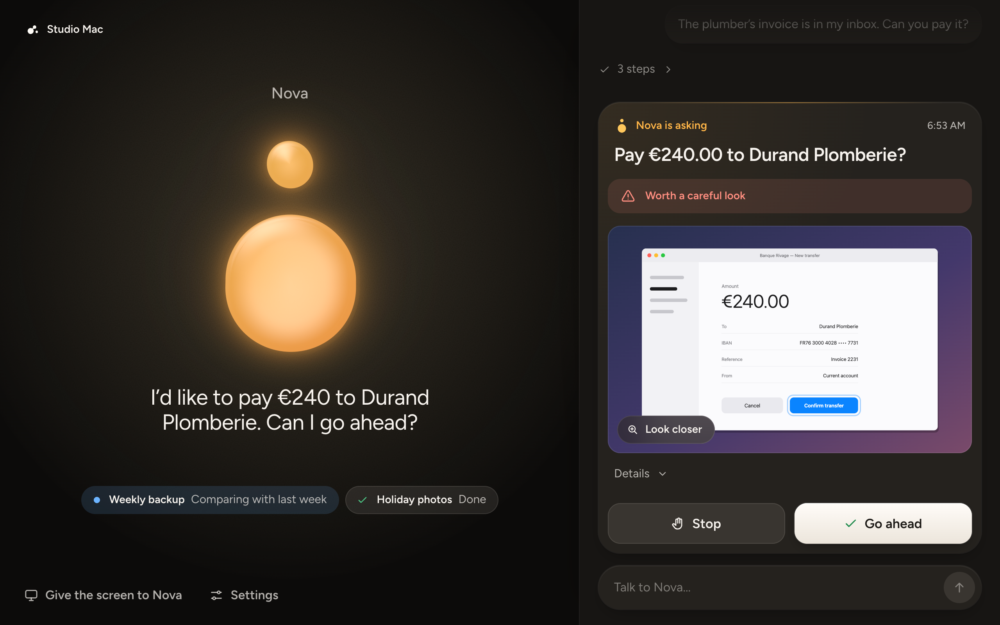
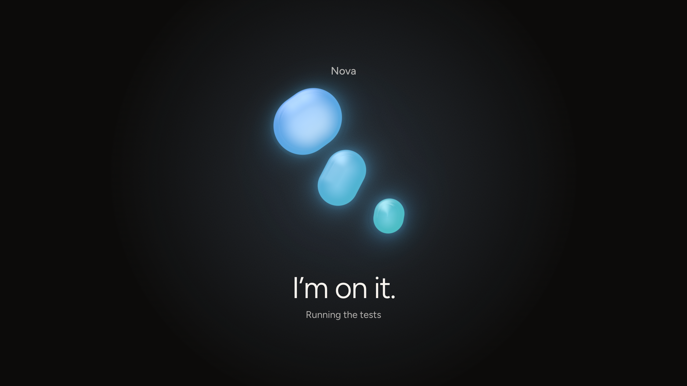
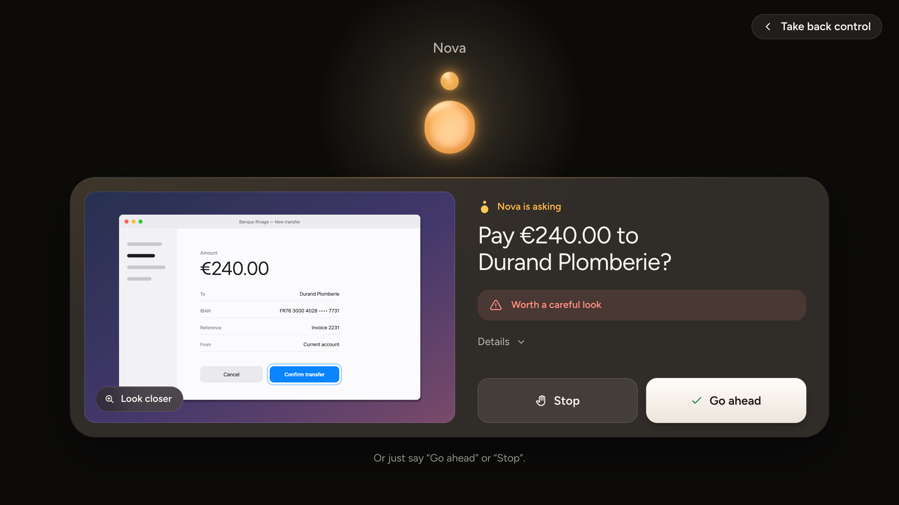
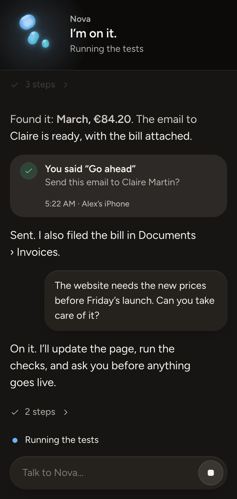
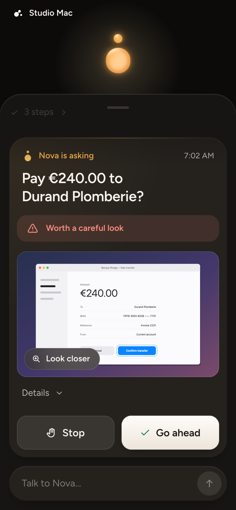
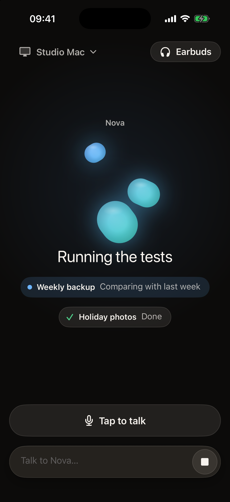
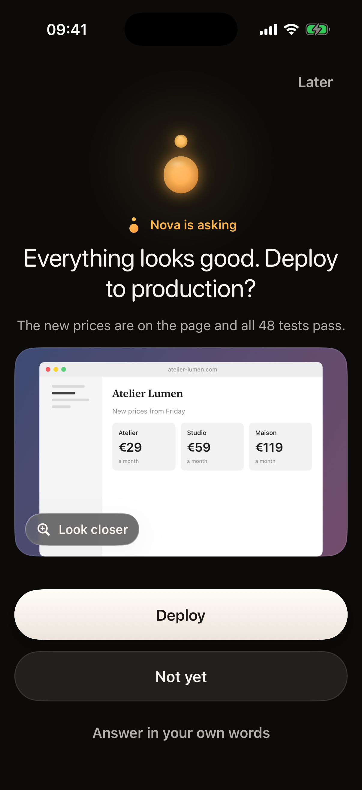
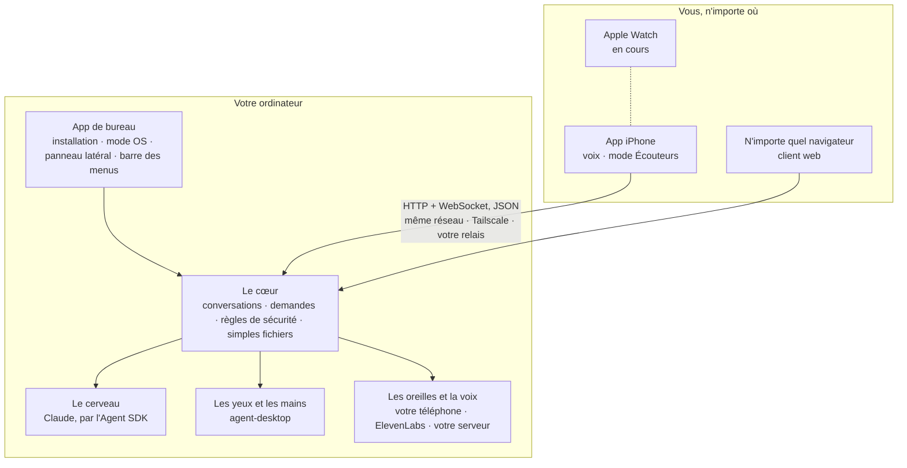

<h1 align="center">
  <picture>
    <source media="(prefers-color-scheme: dark)" srcset="packages/design/brand/logo-on-dark.svg" />
    
  </picture>
</h1>

<div align="center">

**Confiez votre ordinateur à un agent IA. Parlez-lui de n'importe où.**<br />
Depuis votre téléphone ou vos écouteurs, aussi simplement qu'à une personne.

[](https://github.com/Synapsr/AgentOS/actions/workflows/ci.yml)
[](LICENSE)
[](#où-en-est-le-projet)
[](#où-en-est-le-projet)
[](CONTRIBUTING.md)

[**Site web**][site] · [**Obtenir AgentOS**](#obtenir-agentos) · [**Documentation**](docs/README.md) · [**Contribuer**](CONTRIBUTING.md) · [English](README.md)

</div>

<p align="center">
  <a href="docs/PRESENCE.md"></a>
  <br />
  <sub>La présence de l'agent. À chaque état sa forme et son mouvement : un coup d'œil suffit. <a href="docs/PRESENCE.md">Comment elle est dessinée</a> (en anglais)</sub>
</p>

## AgentOS, c'est quoi ?

AgentOS est une app pour votre ordinateur. Elle confie toute la machine à un
agent IA, qui voit l'écran, clique, écrit et travaille dans vos fichiers, et
elle vous laisse lui parler depuis votre téléphone ou vos écouteurs, comme
vous parleriez à quelqu'un (une app compagnon pour Apple Watch est en
cours). L'agent fait le travail, vous dit comment ça s'est passé, et vous
consulte avant les actions qu'il reconnaît comme risquées, avec une image de
ce qu'il voit et deux boutons.

Le projet est open source et tourne sur votre propre machine : pas de
compte, et aucun serveur AgentOS au milieu. Votre ordinateur ne parle qu'aux
services que vous avez choisis : le modèle qui réfléchit, et une voix si
vous en ajoutez une.

> **Vous êtes parti courir, écouteurs aux oreilles.** À la maison, sur votre
> Mac, Nova vient de passer vingt minutes à mettre les nouveaux prix sur
> votre site. Votre musique baisse. *« Tout est prêt. Je déploie en
> production ? »* Vous répondez « allez-y ». Une minute plus tard : *« C'est
> fait, c'est en ligne. »* Le téléphone n'a pas quitté votre poche.

C'est pour cette scène qu'AgentOS existe. Chacun de ses morceaux fonctionne
aujourd'hui ; la dernière étape, les mains libres avec de vrais écouteurs,
n'a encore tourné que dans le simulateur. [Où en est le projet](#où-en-est-le-projet)
dit précisément ce qui est prouvé et ce qui ne l'est pas.

## À quoi ça ressemble

<p align="center">
  
  <br />
  <sub><b>Une demande.</b> La question, ce que voit l'agent, et deux boutons : <i>Stop</i> et <i>Allez-y</i>. Chaque réponse laisse un reçu.</sub>
</p>

<table>
  <tr>
    <td width="50%"></td>
    <td width="50%"></td>
  </tr>
  <tr>
    <td align="center"><sub><b>Le mode OS.</b> Donnez-lui l'écran : tout le reste s'efface dans le noir, il ne reste que l'agent et une ligne sur ce qu'il fait.</sub></td>
    <td align="center"><sub><b>Quand il a besoin de vous.</b> La même question, où que vous regardiez : l'ordinateur ou le téléphone.</sub></td>
  </tr>
</table>

<table>
  <tr>
    <td width="25%"></td>
    <td width="25%"></td>
    <td width="25%"></td>
    <td width="25%"></td>
  </tr>
  <tr>
    <td align="center"><sub><b>Le panneau latéral</b>, quand vous continuez à utiliser votre ordinateur</sub></td>
    <td align="center"><sub><b>Le client web</b>, dans le navigateur de n'importe quel téléphone</sub></td>
    <td align="center"><sub><b>L'app iPhone</b>, au travail</sub></td>
    <td align="center"><sub><b>L'app iPhone</b>, qui demande</sub></td>
  </tr>
</table>

<p align="center"><sub>De vrais écrans, avec les données de démonstration des apps. Il y en a d'autres dans <a href="docs/screenshots">docs/screenshots</a>, et le mode OS au travail dans <a href="docs/screenshots/os-mode.mp4">un enregistrement de 15 secondes</a>.</sub></p>

## Comment ça marche

Un petit cœur tourne sur votre ordinateur. Il garde la conversation, les
demandes et les règles de sécurité, dans de simples fichiers. Tout le reste
se branche dessus, et tout parle [un seul protocole](docs/protocol.md).



Trois pièces sont remplaçables, chacune derrière une petite interface :

| Pièce | Aujourd'hui | Pour la remplacer |
|---|---|---|
| **Le cerveau** | Claude, par le [Claude Agent SDK](https://platform.claude.com/docs/en/agent-sdk/overview). Un moteur `mock` rejoue un scénario, pour essayer et tester sans clé | Implémentez `Engine` dans [`packages/core/src/engine`](packages/core/src/engine) |
| **Les yeux et les mains** | [agent-desktop](https://github.com/vercel-labs/agent-desktop) : il lit l'arbre d'accessibilité du système et agit sur les boutons, les champs et les menus par référence, sans déplacer votre pointeur. Les captures d'écran sont pour vos yeux à vous | Implémentez `Computer` dans [`packages/computer`](packages/computer) |
| **Les oreilles et la voix** | La voix de votre téléphone, sans clé. Ou ElevenLabs, ou votre propre serveur de synthèse, avec un seul réglage | Ajoutez un fournisseur dans [`packages/voice`](packages/voice) |

Il y a une seule conversation avec votre agent et, en dessous, autant de
tâches de fond qu'il en faut : l'agent les lance pour les longs travaux et
vous prévient quand elles se terminent. La suite dans
[Architecture](docs/ARCHITECTURE.md) (en anglais, comme toute la
documentation détaillée).

## Obtenir AgentOS

**Sur un Mac.** Téléchargez l'app, un `.dmg`, depuis
[les versions publiées sur GitHub](https://github.com/Synapsr/AgentOS/releases/latest),
ouvrez-la, et répondez à quelques questions : votre prénom, un nom pour
votre agent, ce qu'il peut faire sans demander, et une clé Claude. C'est là
que mène le bouton *Télécharger pour Mac* du site. Pour être clair : la
première version n'est pas encore publiée, cette page est donc vide pour
l'instant.

**Pour les développeurs**, et pour qui le veut dès aujourd'hui : compilez-le
depuis les sources, avec le [démarrage rapide](#démarrage-rapide) ci-dessous.

## Démarrage rapide

Compilez AgentOS depuis les sources. Il vous faut
[Node.js](https://nodejs.org) 20.19 ou plus récent et
[pnpm](https://pnpm.io) 10, sur un Mac.

```sh
git clone https://github.com/Synapsr/AgentOS.git
cd AgentOS
pnpm install
pnpm build
AGENTOS_ENGINE=mock pnpm start
```

`AGENTOS_ENGINE=mock` donne à l'agent un cerveau d'entraînement : un
scénario à la place d'un modèle. Pas de clé, aucun coût, et tout le reste
est vrai.

```
  ● Nova veille sur Mac du bureau

  Sur cet ordinateur           http://localhost:4747
  Depuis vos autres appareils  https://192.168.1.24:4747

  Terminez l'installation dans votre navigateur :
  http://localhost:4747/#token=…
```

Ouvrez la dernière adresse. Elle vous demande votre prénom, un nom pour
votre agent, et ce qu'il peut faire sans demander. Dites-lui ensuite de
**déployer** quelque chose : il travaille quelques secondes, puis vous pose
la question.

Vous préférez le terminal ? Dans un second :

```sh
pnpm agentos say "supprime l'ancien build"
```

```
Nova demande : Nova veut supprimer des fichiers
rm -rf ./build
[Allez-y] [Stop]
Répondez avec : pnpm agentos say "<votre réponse>"
```

Le cerveau d'entraînement fait semblant : rien n'est supprimé. `pnpm agentos`
est la commande `agentos`, depuis un clone : `say`, `status`, `pair`, `url`.

**Ensuite, pour de vrai :**

- **Un vrai cerveau.** Arrêtez le cœur et relancez-le sans le mock :
  `pnpm start`. Collez ensuite une clé d'API Anthropic dans Réglages →
  Cerveau. Voir [comment il s'authentifie](#le-cerveau-et-comment-il-sauthentifie).
- **L'app de bureau**, avec le mode OS, le panneau latéral et la barre des
  menus : `pnpm desktop` (il faut [Rust](https://rustup.rs)).
- **Votre téléphone.** `pnpm agentos pair` affiche un QR code. Scannez-le
  avec l'app iPhone. Sans l'app, le client web s'ouvre dans le navigateur du
  téléphone, une fois votre ordinateur joignable par Tailscale ou par un
  relais.

Chaque étape, et quoi faire quand l'une d'elles échoue :
[Getting started](docs/getting-started.md). L'app iPhone se compile avec
Xcode pour l'instant : [The iPhone and Apple Watch apps](docs/ios.md).

## Le joindre de partout

Votre téléphone parle directement à votre ordinateur, sur un seul port.
Trois façons d'y arriver, au choix :

| | Ce que vous installez | Bon à savoir |
|---|---|---|
| **Même réseau** | Rien | Chiffré avec un certificat propre à votre ordinateur, que l'app apprend du code qu'elle scanne. Un navigateur ne peut pas faire cette vérification : le client web a besoin de l'une des deux solutions ci-dessous |
| **Tailscale** | [Tailscale](https://tailscale.com) sur les deux appareils | Aucun serveur. AgentOS le repère et met cette adresse dans le code que scanne votre téléphone |
| **Votre propre relais** | Un petit conteneur sur un serveur à vous | C'est votre ordinateur qui s'y connecte : rien ne s'ouvre sur votre réseau |

Un relais est privé : il ne démarre pas sans un jeton, que votre ordinateur
doit présenter. Tant qu'aucune image n'est publiée, construisez-la d'abord
depuis votre clone
(`docker build -f packages/relay/Dockerfile -t agentos-relay .`), puis :

```sh
RELAY_TOKEN=$(openssl rand -hex 32)
docker run -d -p 8080:8080 -v agentos-relay:/data -e RELAY_TOKEN="$RELAY_TOKEN" agentos-relay
```

Celui qui exploite un relais peut lire tout ce qui y passe, y compris les
jetons qui lui permettraient d'agir comme votre téléphone. Faites donc
tourner le vôtre, et gardez-le privé. Le chiffrement de bout en bout entre
le téléphone et l'ordinateur est prévu. Les détails, HTTPS compris :
[Reach your computer from anywhere](docs/connecting.md).

## La voix

Par défaut, c'est votre téléphone qui écoute et qui parle, avec la voix
intégrée à iOS : pas de clé, rien à régler, et aucun son ne quitte le
téléphone. Pour une voix de meilleure qualité, ajoutez une clé ElevenLabs
dans les Réglages, ou indiquez à AgentOS votre propre serveur de synthèse
(tout serveur qui parle l'API audio d'OpenAI, par exemple des modèles
ouverts sur le même Mac). La clé reste sur votre ordinateur ; le téléphone
ne l'a jamais.

Sur le téléphone, **Touchez pour parler** (touchez, parlez, touchez à
nouveau pour envoyer), ou écrivez. Écouteurs aux oreilles, touchez
**Écouteurs** et rangez le téléphone : l'agent parle par-dessus votre
musique quand il a fini ou qu'il a besoin de vous, puis écoute votre
réponse. La suite dans [Voice](docs/voice.md).

## La sécurité

Vous décidez de ce que l'agent peut faire seul, avec un seul réglage :

| Réglage | Dans l'app | Ce qui se passe |
|---|---|---|
| `supervised` | Demander avant chaque changement | Il demande avant de lancer une commande, de modifier un fichier ou d'agir à l'écran |
| `balanced` (par défaut) | Demander quand ça compte | Il travaille seul, et il est arrêté avant les actions que les règles reconnaissent comme risquées : déployer, publier, une suppression forcée ou récursive, `sudo`, un push forcé |
| `autonomous` | Ne jamais s'arrêter pour demander | Les règles ne l'arrêtent jamais |

Quand il est arrêté, ou quand il choisit de demander, vous recevez **une
demande** : une phrase écrite pour être dite, une capture de ce que voit
l'agent quand elle aide, et deux boutons, *Allez-y* et *Stop*. Vous répondez
depuis n'importe lequel de vos appareils, du doigt ou de la voix, et seul un
oui sans équivoque vaut accord. Quand une étape est risquée, la demande le
dit (« À regarder de près »), et Allez-y demande un geste familier de plus :
Face ID sur l'iPhone, une seconde lecture sur la montre. Stop tient toujours
en un geste, un mot ou la touche Échap. Chaque réponse laisse un reçu : ce
que vous avez dit, quand, et depuis quel appareil.

**Ces règles sont un ralentisseur, pas une garantie.** C'est une liste de
motifs reconnus, qui n'attrape pas toutes les commandes destructrices : un
simple `rm fichier`, un script qui supprime, un envoi avec `curl` passent
sans question. L'agent a aussi pour consigne de demander avant tout ce qui
est irréversible ou tourné vers l'extérieur, comme dépenser de l'argent ou
envoyer un message en votre nom ; qu'il le fasse relève du jugement du
modèle. Et un agent qui lit une page web, un fichier ou un mail hostile peut
être manipulé et faire ce que vous n'avez pas demandé. Les demandes
réduisent ce risque. Elles ne le suppriment pas.

Deux choses encore. Avec le réglage par défaut, les outils que vous avez
connectés à Claude Code (e-mail, agenda, hébergement…) lisent librement et
demandent avant de modifier quoi que ce soit. Et avec un cœur lancé à la
main, un agent qui contourne les motifs des règles peut lire le jeton
d'AgentOS et approuver ses propres demandes. L'app de bureau ne laisse aucun
jeton sur le disque ; le réglage `sandbox` ferme aussi cette porte aux
commandes du shell, au prix d'une vraie gêne dans le travail ordinaire
([ce qu'il coûte](SECURITY.md#the-sandbox-and-what-it-costs), en anglais).

Commencez donc par *Demander avant chaque changement*, sur une machine et un
compte utilisateur que vous acceptez de confier. [SECURITY.md](SECURITY.md)
dit sans détour à qui vous faites confiance et pour quoi, et où sont les
limites. Lisez-le avant de vous reposer sur AgentOS.

## Le cerveau, et comment il s'authentifie

AgentOS réfléchit avec Claude, par le Claude Agent SDK, qui exécute tel quel
le programme Claude Code livré avec lui.

- **Une clé d'API Anthropic** est la façon de lui donner accès. Collez-la
  pendant l'installation ou dans les Réglages, ou définissez
  `ANTHROPIC_API_KEY`. Elle est rangée dans un fichier que seul votre compte
  utilisateur peut lire, l'API ne la renvoie jamais, et Claude Code la reçoit
  par un canal privé : les commandes de l'agent ne la voient pas.
- **Amazon Bedrock et Google Vertex AI** passent par les variables
  d'environnement habituelles de Claude Code (`CLAUDE_CODE_USE_BEDROCK`,
  `CLAUDE_CODE_USE_VERTEX` et vos identifiants cloud), que le cœur transmet
  sans y toucher.

AgentOS n'a pas de connexion à lui et ne propose pas de connexion claude.ai :
les conditions d'Anthropic ne le permettent pas aux produits tiers. Comme le
moteur est le programme Claude Code non modifié, sur un ordinateur où vous
vous êtes déjà connecté vous-même à Claude Code, il utilise ce qui y est en
place, comme il le ferait dans votre terminal, avec les outils que vous y
avez connectés. L'app vous le dit quand c'est le cas. AgentOS ne lit, ne
stocke et ne transmet jamais ces identifiants.

## Configuration

Tout a une valeur par défaut, et les réglages se changent depuis l'app. Une
variable d'environnement, quand elle est définie, l'emporte sur le réglage
de l'app et n'est jamais écrite sur le disque. Les plus utiles :

| Variable | Rôle | Par défaut |
|---|---|---|
| `AGENTOS_HOME` | Le dossier où tout est gardé | `~/.agentos` |
| `AGENTOS_PORT` | Le port | `4747` |
| `AGENTOS_ENGINE` | `claude` ou `mock` | `claude` |
| `AGENTOS_MODEL` | Le modèle, par exemple `claude-opus-5-5` | Celui du moteur |
| `ANTHROPIC_API_KEY` | La clé du moteur Claude | Celle des Réglages |
| `AGENTOS_VOICE` | `device`, `elevenlabs` ou `local` | `device` |
| `ELEVENLABS_API_KEY` | La clé de la voix ElevenLabs | Celle des Réglages |
| `AGENTOS_VOICE_URL` | Votre serveur de synthèse, pour `local` | Aucun |
| `AGENTOS_RELAY_URL` | Le relais auquel se connecter | Aucun |
| `AGENTOS_HOST` | L'adresse d'écoute, aussi `--host`. `127.0.0.1` tient tous les autres appareils à l'écart | Toutes les interfaces |
| `AGENTOS_SANDBOX` | `1` fait tourner les commandes de l'agent dans le bac à sable de Claude Code : [ce qu'il ferme, et ce qu'il coûte](SECURITY.md#the-sandbox-and-what-it-costs) | Désactivé |
| `AGENTOS_PROJECT_SETTINGS` | `1` laisse s'appliquer les réglages Claude Code propres à un dossier de projet, hooks et serveurs compris | Désactivé |

La liste complète, et ce que contient `~/.agentos` :
[Architecture](docs/ARCHITECTURE.md#configuration).

## Ce qu'il y a dans ce dépôt

| Chemin | Quoi |
|---|---|
| [`packages/protocol`](packages/protocol) | Le protocole, et son schéma JSON. Le contrat que tout le monde suit |
| [`packages/core`](packages/core) | Le cœur, et la commande `agentos` |
| [`packages/computer`](packages/computer) | Les yeux et les mains : écran, arbre de l'interface, souris, clavier |
| [`packages/voice`](packages/voice) | Les oreilles et la voix : les fournisseurs de voix |
| [`packages/ui`](packages/ui) | L'interface servie par le cœur : installation, accueil, mode OS, panneau latéral, client web (React) |
| [`packages/design`](packages/design) | Le design system sous forme de code : un seul `tokens.json`, généré pour le web et pour Swift, la police Figtree, et la marque |
| [`packages/presence`](packages/presence) | La présence de l'agent : un modèle pur et un petit moteur de rendu |
| [`packages/relay`](packages/relay) | Le relais |
| [`apps/desktop`](apps/desktop) | L'app de bureau : une fine coque autour du cœur (Tauri 2, Rust) |
| [`apps/ios`](apps/ios) | Les apps iPhone et Apple Watch (SwiftUI) |
| [`apps/site`](apps/site) | Le site web (Astro) |
| [`docs`](docs/README.md) | L'architecture, le design, la présence et les guides |

## Où en est le projet

AgentOS en est à la version 0.1. La boucle complète fonctionne : vous
demandez, il travaille, il vous pose une question, vous répondez. Voici ce
qui a été prouvé, et comment.

**Fonctionne, testé sur macOS avec Apple Silicon**

- Le cœur, avec le cerveau d'entraînement et avec le vrai Claude
- Le contrôle de l'ordinateur, par agent-desktop
- Le client web
- Le relais, lancé comme un simple processus
- La voix ElevenLabs, avec une vraie clé
- L'app de bureau, mode OS compris, et une `AgentOS.app` autonome (signée
  ad hoc, non notarisée ; il reste des vérifications visuelles à faire sur
  l'app empaquetée)
- L'app iPhone, dans le simulateur, face au vrai cœur

**Construit, pas encore vérifié en conditions réelles**

- La voix du téléphone et le mode Écouteurs, sur un vrai iPhone avec des
  écouteurs
- Les notifications par les serveurs d'Apple, qui demandent la clé Apple de
  celui qui compile l'app
- L'image Docker du relais, qui n'a pas encore tourné
- L'app compagnon pour Apple Watch : construite et lancée dans le
  simulateur, pas encore sur une vraie montre

**Pas encore là**

- Les téléchargements : l'app pour Mac arrive avec la première version
  publiée, sur GitHub ; pour l'instant, on compile depuis les sources
- Windows et Linux : prévus dans la conception, ni compilés ni testés
- Android : prévu, rien n'existe
- Le chiffrement de bout en bout à travers un relais

AgentOS a fait l'objet d'une revue de sécurité indépendante, ce qui n'est
pas un audit, et il n'existe pas encore de version signée. Voyez-le comme un
logiciel jeune, et confiez-lui un ordinateur en conséquence :
[SECURITY.md](SECURITY.md).

## La suite

Dans cet ordre, à peu près : vérifier la voix et les notifications sur du
vrai matériel ; l'app compagnon sur une vraie Apple Watch ; des téléchargements signés pour macOS et
des versions de l'app iPhone qu'on n'a pas à compiler ; une image publiée du
relais ; le chiffrement de bout en bout à travers un relais ; Windows et
Linux ; Android. D'autres modèles peuvent déjà se brancher derrière
l'interface du moteur, et sont les bienvenus.

## Contribuer

Les rapports de bug, les idées et les pull requests sont les bienvenus.
Commencez par [CONTRIBUTING.md](CONTRIBUTING.md) (en anglais) : la mise en
place, les quelques règles du dépôt, et comment lancer et tester chaque
partie. Une commande lance ce que lance la CI : `pnpm check`. AgentOS veut
rester petit et évident ; avant d'ajouter un réglage, demandez-vous si un
meilleur réglage par défaut ne suffirait pas.

- [Signaler un bug](https://github.com/Synapsr/AgentOS/issues/new?template=bug_report.yml)
- [Proposer une idée](https://github.com/Synapsr/AgentOS/issues/new?template=idea.yml)
- Un problème de sécurité ? N'ouvrez pas d'issue : voyez [SECURITY.md](SECURITY.md).

Si AgentOS vous est utile, une étoile aide d'autres personnes à le trouver.

## Remerciements

AgentOS s'appuie sur le travail des autres :

- [agent-desktop](https://github.com/vercel-labs/agent-desktop), de Vercel
  Labs, donne à l'agent ses yeux et ses mains.
- Le [Claude Agent SDK](https://platform.claude.com/docs/en/agent-sdk/overview),
  d'Anthropic, est son cerveau.
- [Tauri](https://tauri.app) fait la coque de l'app de bureau ;
  [Hono](https://hono.dev), [ws](https://github.com/websockets/ws) et
  [zod](https://zod.dev) portent le cœur ; [React](https://react.dev),
  [Vite](https://vite.dev) et [Motion](https://motion.dev) l'interface ;
  [Astro](https://astro.build) le site.
- [Figtree](https://github.com/erikdkennedy/figtree), d'Erik Kennedy, est la
  typographie de l'interface, du logo et du site.
- Les membranes entre les gouttes de la présence suivent les metaballs de
  Hiroyuki Sato.

Les licences et les mentions sont dans
[THIRD_PARTY_NOTICES.md](THIRD_PARTY_NOTICES.md).

## Licence

[MIT](LICENSE). Elle couvre le code d'AgentOS. Le Claude Agent SDK, que
`pnpm install` télécharge, appartient à Anthropic et relève de ses propres
conditions.

[site]: https://os.synapsr.io
