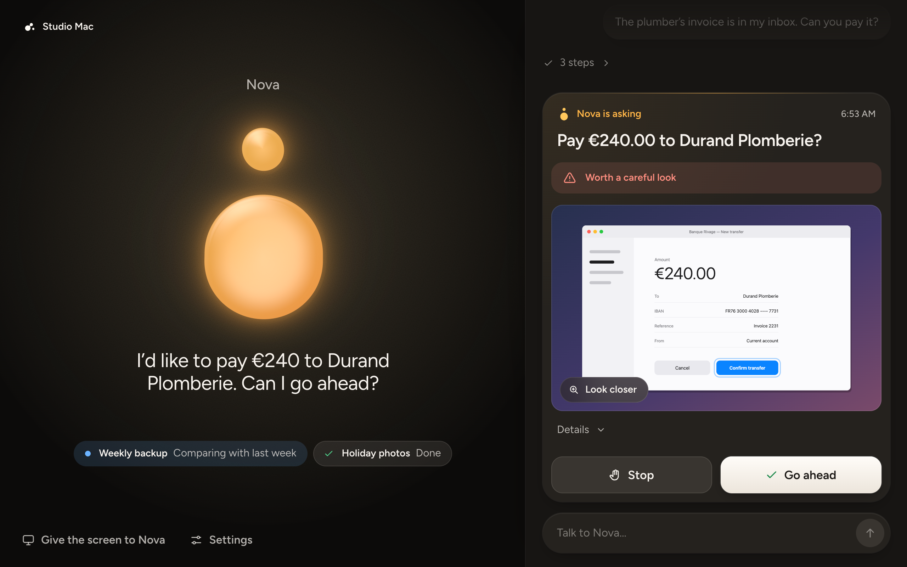
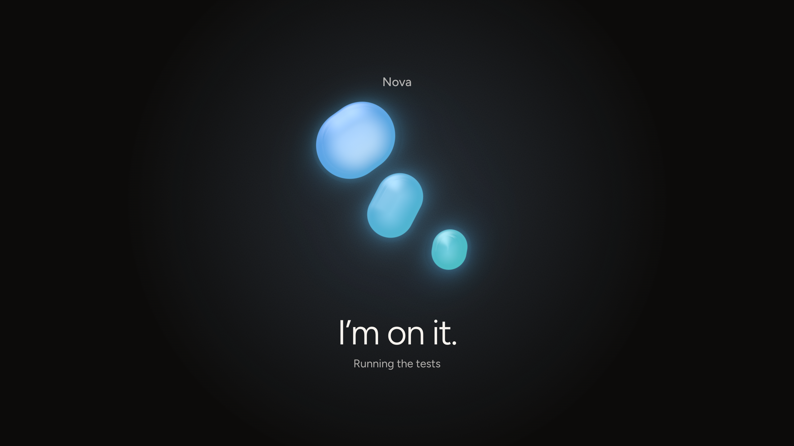
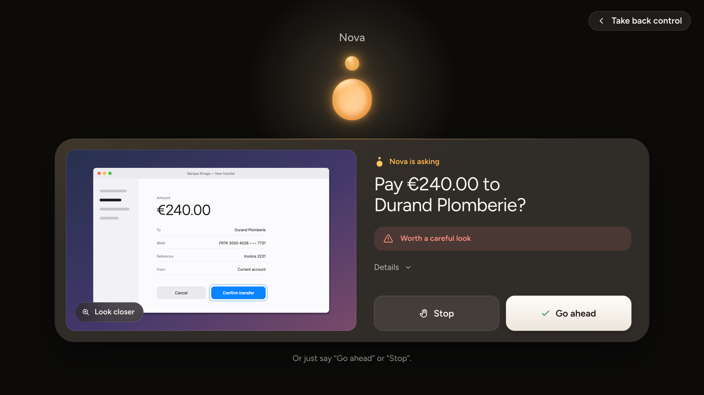
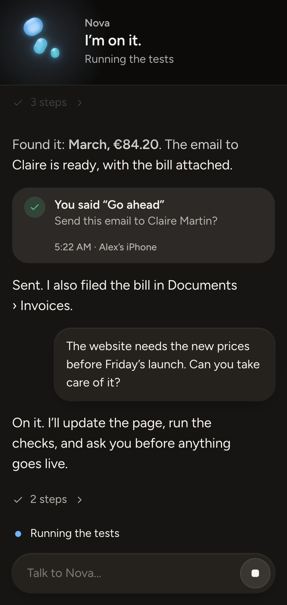
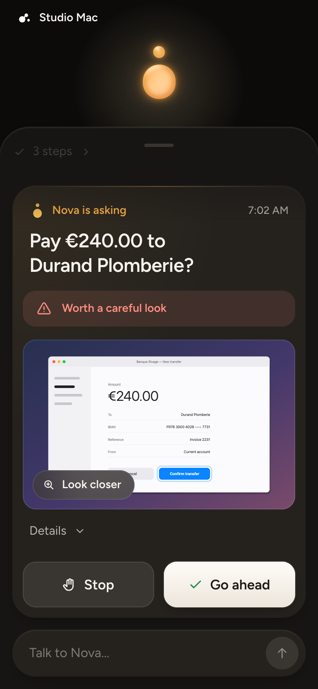
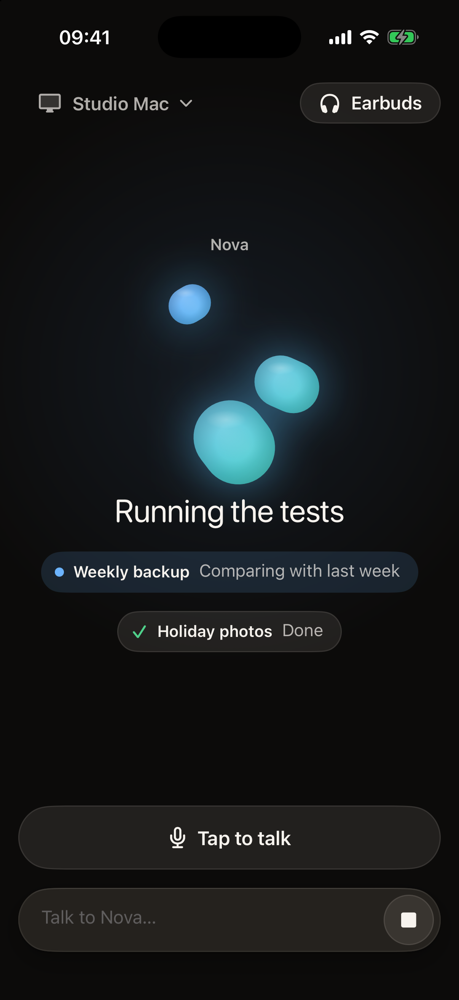
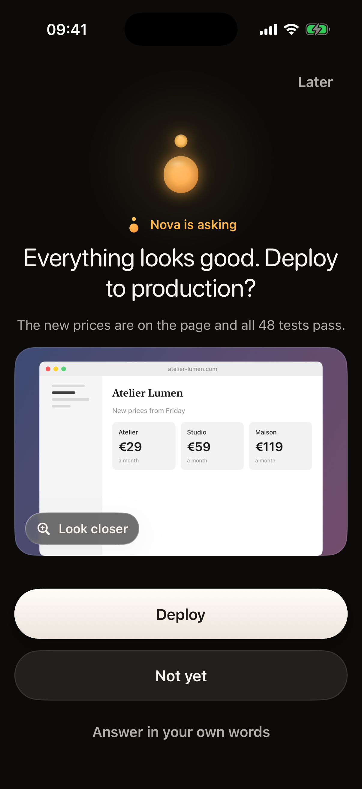
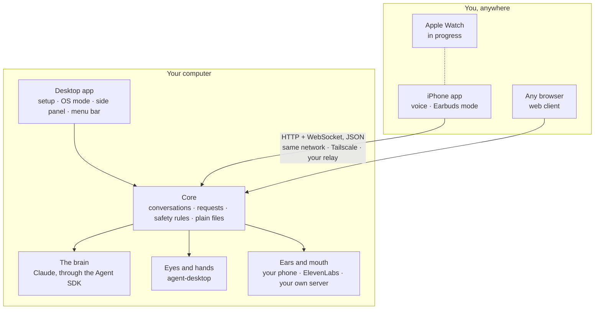

<h1 align="center">
  <picture>
    <source media="(prefers-color-scheme: dark)" srcset="packages/design/brand/logo-on-dark.svg" />
    
  </picture>
</h1>

<div align="center">

**Give an AI agent your computer. Talk to it from anywhere.**<br />
From your phone or your earbuds, as simply as talking to a person.

[](https://github.com/Synapsr/AgentOS/actions/workflows/ci.yml)
[](LICENSE)
[](#status)
[](#status)
[](CONTRIBUTING.md)

[**Website**][site] · [**Get AgentOS**](#get-agentos) · [**Docs**](docs/README.md) · [**Contributing**](CONTRIBUTING.md) · [Français](README.fr.md)

</div>

<p align="center">
  <a href="docs/PRESENCE.md"></a>
  <br />
  <sub>The agent's presence. Each state is a different shape doing a different thing, so you can read it at a glance. <a href="docs/PRESENCE.md">How it is drawn</a></sub>
</p>

## What is AgentOS?

AgentOS is an app for your computer. It hands the whole machine to an AI
agent, which sees the screen, clicks, types and works on your files, and it
lets you talk to that agent from your phone or your earbuds, the way you
would talk to a person (an Apple Watch companion is in progress). The agent
does the work, tells you how it went, and checks with you before the actions
it recognises as risky, with a picture of what it sees and two buttons.

It is open source and it runs on your own machine: no account, and no
AgentOS server in the middle. Your computer only talks to the services you
choose: the model that thinks, and a voice if you add one.

> **You are out for a run, earbuds in.** At home, on your Mac, Nova has spent
> twenty minutes putting the new prices on your website. Your music dips.
> *"Everything looks good. Can I deploy to production?"* You say "go ahead".
> A minute later: *"Done. It's live."* The phone never left your pocket.

That scene is what AgentOS is built for. Every part of it exists today; the
last step, hands-free through real earbuds, has so far only run in the
simulator. [Status](#status) says exactly what is proven and what is not.

## What it looks like

<p align="center">
  
  <br />
  <sub><b>A request.</b> The question, what the agent sees, and two buttons: <i>Stop</i> and <i>Go ahead</i>. Every answer leaves a receipt.</sub>
</p>

<table>
  <tr>
    <td width="50%"></td>
    <td width="50%"></td>
  </tr>
  <tr>
    <td align="center"><sub><b>OS mode.</b> Hand it the screen: everything else goes dark, and only the agent is left, with one line about what it is doing.</sub></td>
    <td align="center"><sub><b>When it needs you.</b> The same question, wherever you are looking: the computer or the phone.</sub></td>
  </tr>
</table>

<table>
  <tr>
    <td width="25%"></td>
    <td width="25%"></td>
    <td width="25%"></td>
    <td width="25%"></td>
  </tr>
  <tr>
    <td align="center"><sub><b>Side panel</b>, for when you keep using your computer</sub></td>
    <td align="center"><sub><b>Web client</b>, in any phone's browser</sub></td>
    <td align="center"><sub><b>iPhone app</b>, at work</sub></td>
    <td align="center"><sub><b>iPhone app</b>, asking</sub></td>
  </tr>
</table>

<p align="center"><sub>Real screens, showing the apps' own demo data. More in <a href="docs/screenshots">docs/screenshots</a>, and OS mode at work in <a href="docs/screenshots/os-mode.mp4">a 15-second recording</a>.</sub></p>

## How it works

One small core runs on your computer. It keeps the conversation, the
requests and the safety rules, in plain files. Everything else plugs into
it, and everything speaks [one protocol](docs/protocol.md).



Three parts are replaceable, each behind one small interface:

| Part | Today | To replace it |
|---|---|---|
| **The brain** | Claude, through the [Claude Agent SDK](https://platform.claude.com/docs/en/agent-sdk/overview). A `mock` engine replays a script, for trying and testing without a key | Implement `Engine` in [`packages/core/src/engine`](packages/core/src/engine) |
| **Eyes and hands** | [agent-desktop](https://github.com/vercel-labs/agent-desktop): it reads the system's accessibility tree and acts on buttons, fields and menus by reference, without moving your pointer. Screenshots are for your eyes | Implement `Computer` in [`packages/computer`](packages/computer) |
| **Ears and mouth** | Your phone's own speech, with no key. Or ElevenLabs, or your own speech server, with one setting | Add a provider in [`packages/voice`](packages/voice) |

There is one conversation with your agent, and under it any number of
background jobs, which the agent starts for long work and reports on when
they finish. More in [Architecture](docs/ARCHITECTURE.md).

## Get AgentOS

**On a Mac.** Download the app, a `.dmg`, from
[GitHub Releases](https://github.com/Synapsr/AgentOS/releases/latest), open
it, and answer a few questions: your name, a name for your agent, how much
it should ask, and a Claude key. That is where the website's *Download for
Mac* leads. It is for Macs with Apple silicon (M1 or later), signed and
notarized by Apple.

**For developers**, and anyone who wants it today: build it from source,
with the [quick start](#quick-start) below.

## Quick start

Build AgentOS from source. You need [Node.js](https://nodejs.org) 20.19 or
later and [pnpm](https://pnpm.io) 10, on a Mac.

```sh
git clone https://github.com/Synapsr/AgentOS.git
cd AgentOS
pnpm install
pnpm build
AGENTOS_ENGINE=mock pnpm start
```

`AGENTOS_ENGINE=mock` gives the agent a practice brain: a script instead of a
model. No key, no cost, and everything else is real.

```
  ● Nova is awake on Studio Mac

  On this computer         http://localhost:4747
  From your other devices  https://192.168.1.24:4747

  Finish setting up in your browser:
  http://localhost:4747/#token=…
```

Open the last address. It asks your name, a name for your agent, and how
much it should ask. Then tell it to **deploy** something: it works for a few
seconds, and asks you first.

Prefer a terminal? In a second one:

```sh
pnpm agentos say "delete the old build"
```

```
Nova is asking: Nova wants to delete files
rm -rf ./build
[Go ahead] [Stop]
Answer with: pnpm agentos say "<your answer>"
```

The practice brain only pretends: nothing is deleted. `pnpm agentos` is the
`agentos` command, from a clone: `say`, `status`, `pair`, `url`.

**Then, for the real thing:**

- **A real brain.** Stop the core and start it again without the mock:
  `pnpm start`. Then paste an Anthropic API key in Settings → Brain. More in
  [how it signs in](#the-brain-and-how-it-signs-in).
- **The desktop app**, with OS mode, the side panel and the menu bar:
  `pnpm desktop` (needs [Rust](https://rustup.rs)).
- **Your phone.** `pnpm agentos pair` shows a QR code. Scan it with the
  iPhone app. Without the app, the web client opens in your phone's browser,
  once your computer can be reached through Tailscale or a relay.

Every step, with what to do when one fails:
[Getting started](docs/getting-started.md). The iPhone app is built with
Xcode for now: [The iPhone and Apple Watch apps](docs/ios.md).

## Reach it from anywhere

Your phone talks to your computer directly, on one port. Three ways to make
that work, your choice:

| | You set up | Good to know |
|---|---|---|
| **Same network** | Nothing | Encrypted with a certificate of your computer's own, which the app learns from the code it scans. A browser cannot do that check, so the web client needs one of the two below |
| **Tailscale** | [Tailscale](https://tailscale.com) on both devices | No server at all. AgentOS notices it and puts that address in the code your phone scans |
| **Your own relay** | One small container on a server you own | Your computer connects out to it, so nothing opens on your home network |

A relay is private: it does not start without a token, which your computer
must present. One line on any server with Docker:

```sh
RELAY_TOKEN=$(openssl rand -hex 32)
docker run -d -p 8080:8080 -v agentos-relay:/data -e RELAY_TOKEN="$RELAY_TOKEN" ghcr.io/synapsr/agentos-relay
```

Whoever operates a relay can read everything that passes through it,
including the tokens that would let them act as your phone. So run your own,
and keep it private. End-to-end encryption between phone and computer is
planned. The details, HTTPS included:
[Reach your computer from anywhere](docs/connecting.md).

## Voice

By default your phone does the listening and the talking itself, with the
speech built into iOS: no key, nothing to set up, and no audio ever leaves
the phone. For a premium voice, add one ElevenLabs key in Settings, or point
AgentOS at your own speech server (any server that speaks the OpenAI audio
API, such as open models running on the same Mac). The key stays on your
computer; the phone never has it.

On the phone, **Tap to talk** (tap, speak, tap again to send), or type. With
earbuds in, tap **Earbuds** and put the phone away: the agent speaks over
your music when it finishes or needs you, and listens for your answer. More
in [Voice](docs/voice.md).

## Safety

You decide how much the agent may do alone, with one setting:

| Setting | In the app | What happens |
|---|---|---|
| `supervised` | Ask before every change | It asks before running a command, changing a file or acting on the screen |
| `balanced` (default) | Ask when it matters | It works on its own, and is stopped before the actions the rules recognise as risky: deploying, publishing, a forced or recursive delete, `sudo`, a force-push |
| `autonomous` | Never stop to ask | The rules never stop it |

When it is stopped, or when it chooses to ask, you get **a request**: one
sentence written to be spoken, a screenshot of what the agent sees when that
helps, and two buttons, *Go ahead* and *Stop*. You can answer from any of
your devices, by tap or by voice, and only an unmistakable yes approves.
When a step is risky the request says so ("Worth a careful look"), and Go
ahead asks for one more familiar gesture: Face ID on the iPhone, a second
look on the watch. Stop is always one tap, one word or the Esc key. Every
answer leaves a receipt: what you said, when, and from which device.

**The rules are a speed bump, not a guarantee.** They are a list of
recognised patterns, and they do not catch every destructive command: a
plain `rm file`, a script that deletes, an upload with `curl` pass without a
question. The agent is also instructed to ask before anything irreversible
or outward-facing, such as spending money or sending a message in your
name; whether it does rests on the model's judgement. And an agent that
reads a hostile web page, file or email can be manipulated into doing
something you did not ask for. The requests reduce that risk. They do not
remove it.

Two more things to know. In the default setting, the tools you connected to
Claude Code (mail, calendars, hosting…) read freely and ask before changing
anything. And with a core you started by hand, an agent that gets round the
rules' patterns can read AgentOS's own token and approve its own requests.
The desktop app leaves no token on disk; the `sandbox` setting closes that
door for shell commands too, at a real cost to ordinary work
([what it costs](SECURITY.md#the-sandbox-and-what-it-costs)).

So start with *Ask before every change*, on a machine and a user account
you are comfortable giving away. [SECURITY.md](SECURITY.md) says plainly who
is trusted with what and where the limits are. Read it before you rely on
AgentOS.

## The brain, and how it signs in

AgentOS thinks with Claude through the Claude Agent SDK, which runs the
unmodified Claude Code program that ships inside it.

- **An Anthropic API key** is the way to give it access. Paste it during
  setup or in Settings, or set `ANTHROPIC_API_KEY`. It is stored in one file
  that only your user account can read, the API never returns it, and
  Claude Code receives it on a private pipe, so the agent's own commands do
  not see it.
- **Amazon Bedrock and Google Vertex AI** work through Claude Code's usual
  environment variables (`CLAUDE_CODE_USE_BEDROCK`, `CLAUDE_CODE_USE_VERTEX`
  and your cloud credentials), which the core passes on untouched.

AgentOS has no sign-in of its own and does not offer a claude.ai login:
Anthropic's terms do not allow third-party products to do that. Because the
engine is the unmodified Claude Code program, on a computer where you have
already signed in to Claude Code yourself it uses what is set up there, as
it would in your terminal, and the tools you connected to it come with it.
The app says so when that is the case. AgentOS never reads, stores or
forwards those credentials.

## Configuration

Everything has a default, and settings are changed from the app. An
environment variable, when set, wins over the app's setting and is never
written to disk. The ones you are most likely to use:

| Variable | Meaning | Default |
|---|---|---|
| `AGENTOS_HOME` | Where everything is kept | `~/.agentos` |
| `AGENTOS_PORT` | The port | `4747` |
| `AGENTOS_ENGINE` | `claude` or `mock` | `claude` |
| `AGENTOS_MODEL` | The model, for example `claude-opus-5-5` | The engine's own default |
| `ANTHROPIC_API_KEY` | The key for the Claude engine | The one saved in Settings |
| `AGENTOS_VOICE` | `device`, `elevenlabs` or `local` | `device` |
| `ELEVENLABS_API_KEY` | The key for the ElevenLabs voice | The one saved in Settings |
| `AGENTOS_VOICE_URL` | Your own speech server, for `local` | None |
| `AGENTOS_RELAY_URL` | The relay to connect out to | None |
| `AGENTOS_HOST` | The address to listen on, also `--host`. `127.0.0.1` keeps every other device out | Every interface |
| `AGENTOS_SANDBOX` | `1` runs the agent's shell commands in Claude Code's sandbox: [what it closes, and what it costs](SECURITY.md#the-sandbox-and-what-it-costs) | Off |
| `AGENTOS_PROJECT_SETTINGS` | `1` lets a project folder's own Claude Code settings apply, its hooks and servers included | Off |

The full list, and what is in `~/.agentos`:
[Architecture](docs/ARCHITECTURE.md#configuration).

## What is in this repository

| Path | What |
|---|---|
| [`packages/protocol`](packages/protocol) | The wire protocol, and its JSON Schema. The contract every part follows |
| [`packages/core`](packages/core) | The core, and the `agentos` command |
| [`packages/computer`](packages/computer) | Eyes and hands: screen, interface tree, mouse, keyboard |
| [`packages/voice`](packages/voice) | Ears and mouth: the speech providers |
| [`packages/ui`](packages/ui) | The interface the core serves: setup, home, OS mode, side panel, web client (React) |
| [`packages/design`](packages/design) | The design system as code: one `tokens.json`, generated for the web and for Swift, the Figtree font, and the brand |
| [`packages/presence`](packages/presence) | The agent's presence: a pure model and a small canvas renderer |
| [`packages/relay`](packages/relay) | The relay |
| [`apps/desktop`](apps/desktop) | The desktop app: a thin shell around the core (Tauri 2, Rust) |
| [`apps/ios`](apps/ios) | The iPhone and Apple Watch apps (SwiftUI) |
| [`apps/site`](apps/site) | The website (Astro) |
| [`docs`](docs/README.md) | Architecture, design, the presence, and the guides |

## Status

AgentOS is at version 0.1. The whole loop works: you ask, it works, it asks
back, you answer. Here is what has been proven, and how.

**Works, and tested on macOS with Apple Silicon**

- The core, with the practice brain and with real Claude
- Controlling the computer, through agent-desktop
- The web client
- The relay, run as a process, and its published image, deployed and tested
  end to end through the internet (pairing, a request answered from outside,
  live events)
- The ElevenLabs voice, with a real key
- The desktop app, OS mode included, and a self-contained `AgentOS.app`,
  signed with a Developer ID and notarized by Apple (some visual checks of the
  bundled app are still to do)
- The iPhone app, in the simulator, against the real core

**Built, not yet verified in real conditions**

- Your phone's own speech, and the Earbuds mode, on a real iPhone with earbuds
- Notifications through Apple's servers, which need the Apple key of
  whoever builds the app
- The relay's Docker image, which has not been run yet
- The Apple Watch companion: built and run in the simulator, not yet on a
  real watch

**Not there yet**

- Downloads: the Mac app comes with the first published version, on
  GitHub Releases; for now, you build from source
- Windows and Linux: designed for, neither built nor tested
- Android: planned, nothing exists
- End-to-end encryption through a relay

AgentOS has had one independent security review, which is not an audit.
Treat it as early software, and give it a computer accordingly:
[SECURITY.md](SECURITY.md).

## Roadmap

In rough order: verifying voice and notifications on real hardware; the
Apple Watch companion on a real watch; builds of the iPhone app you do not
have to compile; end-to-end encryption
through a relay; Windows and Linux; Android. Other models can already plug
in behind the engine interface, and are welcome.

## Contributing

Bug reports, ideas and pull requests are welcome. Start with
[CONTRIBUTING.md](CONTRIBUTING.md): how to set up, the few rules of the
repository, and how to run and test each part. One command runs what CI
runs: `pnpm check`. AgentOS aims to stay small and obvious; before adding a
setting, ask whether a better default would do.

- [Report a bug](https://github.com/Synapsr/AgentOS/issues/new?template=bug_report.yml)
- [Share an idea](https://github.com/Synapsr/AgentOS/issues/new?template=idea.yml)
- Found a security problem? Please do not open an issue: see [SECURITY.md](SECURITY.md).

If AgentOS is useful to you, a star helps other people find it.

## Credits

AgentOS stands on other people's work:

- [agent-desktop](https://github.com/vercel-labs/agent-desktop), by Vercel
  Labs, is the agent's eyes and hands.
- The [Claude Agent SDK](https://platform.claude.com/docs/en/agent-sdk/overview),
  by Anthropic, is its brain.
- [Tauri](https://tauri.app) is the desktop shell;
  [Hono](https://hono.dev), [ws](https://github.com/websockets/ws) and
  [zod](https://zod.dev) carry the core; [React](https://react.dev),
  [Vite](https://vite.dev) and [Motion](https://motion.dev) the interface;
  [Astro](https://astro.build) the website.
- [Figtree](https://github.com/erikdkennedy/figtree), by Erik Kennedy, is the
  typeface of the interface, the wordmark and the website.
- The membranes between the drops of the presence follow Hiroyuki Sato's
  metaballs.

Licences and notices are in [THIRD_PARTY_NOTICES.md](THIRD_PARTY_NOTICES.md).

## License

[MIT](LICENSE). That covers AgentOS's own code. The Claude Agent SDK, which
`pnpm install` downloads, is Anthropic's and comes under Anthropic's own
terms.

[site]: https://os.synapsr.io
