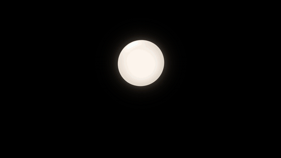

# Design

AgentOS should feel like a presence, not a program. The bar: a grandparent
can install it and use it without help, and a developer wants to show it to a
friend.

This page is the whole design system. The first part says, in plain words,
what AgentOS should look, sound and feel like. The rest is the reference:
every value, component and rule, precise enough to build without guessing.

The values live in one file, [`packages/design/tokens.json`](../packages/design/tokens.json).
The web, the iPhone and the watch all read it (see [Using it](#using-it)).
The presence is specified in [PRESENCE.md](PRESENCE.md).



---

## In plain words

**What it looks like.** A warm, quiet room with one living light in it. The
light is Nova (or whatever the owner calls their agent): three drops that
move as one liquid body. Everything else holds still. Buttons and cards are
solid and soft, like objects you could pick up: lit from above, with a gentle
shadow. In the dark the room is a warm night, never a black terminal. In the
light it is warm daylight.

**How it sounds.** Like a person. Nova speaks in the first person, in short,
plain sentences: "I'm on it." "I'd like to pay €240 to Durand Plomberie. Can
I go ahead?" The interface around it uses the same everyday words: "your
computer", "Add your phone", "Go ahead", "Stop". Commands, addresses and
other technical details are always there for those who want them, one tap
away under "Details" or in Settings > Advanced, never in the way.

**How it feels.** You are always in charge. When Nova needs you it asks
clearly, shows you what it sees, and waits. Stopping is always one tap, one
word or the Esc key. Saying yes to something serious asks for one more,
familiar gesture (Face ID, Touch ID). Every answer leaves a short receipt, so
you can always see what was decided, when, and from where.

**The rules, in one breath.**

1. **One living thing.** Only the presence moves on its own. Everything else
   answers once, then holds still.
2. **Light, not paint.** The presence is made of light. Surfaces are matte
   and lit from above.
3. **One thing per screen.** If a screen needs explaining, it is two screens.
4. **Words first, then shape, then colour.** Every state is said in words,
   shown by a shape, and only then confirmed by colour.
5. **Each colour has one job.** Amber: Nova is asking. Blue: Nova is
   working. Green: done. Red: be careful. The rest is pearl, ink and warm
   greys.
6. **Plain sentence on top, the machine underneath.** Everyone reads "Nova
   wants to delete files". Technical users open "Details" for the command.
7. **Friction follows consequence.** Stopping is one act. Saying yes to
   something serious asks for the device's own trust gesture, never a new
   gesture to learn.
8. **Every answer closes the loop.** A receipt, a haptic on the confirmed
   outcome, and Nova visibly reacting.
9. **Big enough for anyone.** 44 pt targets at the very least, 52 to 64 for
   decisions, nothing a person must read under 15 px.
10. **Calm after ten minutes.** If a screen does not feel calm after ten
    minutes of looking at it, it is wrong.

---

## The presence

The agent is drawn as three drops of light that behave as one liquid body.
It is the only brand element: no mascot, no avatar, no robot, no face. Its
motion, material and drawing are specified in [PRESENCE.md](PRESENCE.md);
this section fixes what it means and its colours.

| State | Meaning | Shape | Colour (dark / light surfaces) |
|---|---|---|---|
| `idle` | Nothing to do | One round body, breathing | **Pearl**, a warm white / a black pearl |
| `working` | Busy | Three drops juggling, merging as they cross | **Lagoon**, azure into aqua |
| `waiting` | Needs its owner | The body standing, a small drop raised above it | **Amber** |
| `listening` | Hearing the owner | One soft body that leans in and swells with the voice | White with a cool edge / ink with a blue edge |
| `speaking` | Talking | A row, small, big, small, that moves with each syllable | White with a warm edge / ink with a warm edge |
| `offline` | Can't work | A flat dash, still | Warm grey: asleep, not broken |

Its colours per state are in `presence` in the tokens: the body's gradient
(`from` top left, `to` bottom right), its inner `core` (the brightest light
inside the body), its `halo` and `glow`. On light surfaces it becomes a
**black pearl**: ink with a glossy core, and a soft coloured glow for the
coloured states only. A change between two coloured states travels through
light (`presence.via`), never through the muddy mix of the two.

**The stage light.** The presence's light falls on the surface around it: a
radial gradient of its state colour at 10 % (`--stage-light`), about 2.2
times the stage wide. It is what turns a dark field into a room. It follows
the state on the material spring. Off on the watch (Always On, battery).

**The presence with its label** is the product's signature component:

- the agent's **name** above, in `text-dim`: `label` above a small stage,
  `name-large` above a large one (OS mode, a window);
- the **stage**, a square the figure moves in. The body at rest fills half
  of it; the name and the line may sit within its outer edge;
- the agent's **line** below, in Display type: one sentence, first person,
  balanced, at most 20 em wide. A new line replaces the old one in two beats:
  the old one fades out in 120 ms (ease in), then the new one fades in in
  200 ms (ease out), so that two sentences are never on screen at once. It is
  announced to screen readers (`aria-live="polite"`). The line never
  contradicts the conversation: when the last activity is over, the line
  is over too.

**The stage** has one size per surface, in the `stage` tokens:

| Where | Token | Stage |
|---|---|---|
| OS mode | `os` | 56 % of the height, at most 90 % of the width; 160–600 |
| OS mode, while asking | `os-asking` | 24 % of the height; 120–260: the presence rises above the request |
| Home, the conversation below (a phone) | `home` | 30 % of the height; 160–300 |
| Home on a phone, while asking | `home-asking` | 96: the presence steps aside |
| Home, the conversation beside (a window) | `home-beside` | the smaller of 72 % of its own column and 50 % of the height; 160–440 |
| Onboarding, adding a phone | `onboarding` | 30 % of the height; 140–240 |
| Watch | `watch` | 120 |
| Watch, while asking | `watch-asking` | 36, beside "Nova is asking" |
| The side panel's header | `panel` | 80 |
| The side panel's header, while asking | `panel-asking` | 48 |
| A row in a list of computers | `row` | 32 |
| The agent's turn, with no other presence in view | `inline` | 24 |
| Beside "Nova is asking" and in chips | `label` | 20: a still glyph of the state |
| Menu bar | (glyph) | 18 pt, a still glyph of the state: see *Brand* |
| Favicon, app icon | (mark) | the mark; it does not move |

`stageSize(surface, { width, height })` in `@agentos/design` applies these
rules; Swift reads `Tokens.Stage`. A change of stage is a movement, never a
jump.

Do: let it be the only thing that moves on its own · give it the stage
surface, or a plain utility surface · always pair it with words.
Don't: recolour it, outline it, put it in a card, on a photo or on a
gradient other than its own light · show two large ones on one screen · use
its amber or its motion for anything else · use it as a loading spinner ·
animate "working" when nothing runs.

---

## Colour

Warm, not neutral. The dark theme is a warm night (graphite with a hint of
brown, never blue-black). The light theme is warm daylight (paper white,
never cream). Both are first class. Everything follows the owner's
appearance except **OS mode and the watch, which are always dark**.

### Surfaces and depth

Depth comes from light above: a higher surface is lighter, carries a 1 px
highlight on its top edge, and casts a soft shadow. Two levels at most on a
screen.

| Token | Dark | Light | Use |
|---|---|---|---|
| `black` | `#000000` | `#000000` | The watch; the extra screens OS mode covers |
| `surface-stage` | `#0C0B0A` | `#EEECE8` | Where the presence lives: home stage, panel header, phone home, OS mode |
| `surface` | `#171513` | `#F3F2F0` | The page of a utility surface: conversation column, panel, settings, onboarding |
| `surface-raised` | `#25221E` | `#FFFFFF` | Cards, groups of rows, bubbles, the request; always with `shadow-raised` |
| `surface-overlay` | `#302C28` | `#FFFFFF` | Things that float: sheets, menus, toasts, the OS-mode request; always with `shadow-overlay` |
| `glass` | warm graphite 72 % | white 72 % | Controls floating over content, with `--glass-filter` (blur 24, saturate 150 %). Never glass on glass, never glass on an empty stage |

`shadow-raised`, `shadow-overlay` and `shadow-button` are complete: top
highlight, 1 px ring, and two soft shadow layers (one tight, one long).
Use them as they are; never write a shadow by hand.

### Text, lines and fills

| Token | Dark | Light | Use |
|---|---|---|---|
| `text` | `#F7F3EE` | `#1D1A17` | Primary text |
| `text-dim` | text at 70 % | text at 68 % | Secondary text. Readable on every surface |
| `text-faint` | 42 % | 42 % | Placeholders, disabled labels: never something that must be read |
| `line` | white 8 % | ink 8 % | Hairlines between rows |
| `line-strong` | text 90 % | text 85 % | The edge of a selected choice |
| `ring` | white 10 % | ink 14 % | The 1 px edge of a control |
| `outline` | pure white 10 % | pure black 10 % | Around pictures |
| `fill` / `fill-strong` | white 9 % / 14 % | ink 7 % / 11 % | Secondary buttons, chips, fields, icon tiles; and their hover |
| `focus` | `#6CB4FF` | `#1A63C0` | The keyboard focus ring, as on every Mac |
| `scrim` | | | Behind a sheet |

### Colours with one job each

| Token | Dark | Light | Its one job |
|---|---|---|---|
| `primary` (+ `-top`, `-bottom`, `-highlight`) | pearl `#F4EEE6` | ink `#24201C` | The primary button: made of the presence's own pearl |
| `on-primary` | `#1D1A17` | `#FBF8F4` | Its label |
| `primary-check` | `#1E8A4C` | `#4FD18B` | The check on Go ahead: the only colour on it |
| `waiting` (+ `-fill`) | `#FFB547` | `#965600` | Nova is asking. Nothing else is amber |
| `asking-light` | amber | amber | The presence's light on a request: the card's top edge and corner wash. Never text |
| `working` (+ `-fill`) | `#6CB4FF` | `#1A63C0` | Nova is working: activity dots, working chips, progress |
| `go` (+ `-fill`) | `#4FD18B` | `#1E8A4C` | Done, approved: checks and receipts. Icons only, never a button fill |
| `careful` (+ `-fill`, `-fill-strong`) | `#FF8E80` | `#B02E25` | Be careful: high risk, errors, options marked `danger` |

**Red never means Stop.** Stopping is the safe choice; it is never painted
as danger. Red is for "be careful" only.

**Risk** is said in words, shown by an icon and confirmed by colour, never
colour alone. Only high risk is called out (see *The request*): a warning on
every request is a warning on none.

**Contrast.** Text passes 4.5 : 1 and icons 3 : 1 on every surface, in
both appearances, including the careful banner and both buttons. The tests
in `packages/design` check it every build.

---

## Type

**One family on the web: [Figtree](https://github.com/erikdkennedy/figtree)**,
for the apps, the desktop shell and the website alike. Its round,
open forms answer the drops, it stays legible at small sizes, and it is under
the SIL Open Font License. It ships in `packages/design/fonts` (one 12 kB
variable file, weights 300–600, English and French) and `tokens.css` loads
it: the UI works offline, with no font fetched from anywhere.

**On the iPhone and the watch: the system font.** SF Pro for the interface
and **SF Pro Rounded** (`Font.Design.rounded`) for the agent's voice, the
system face closest to Figtree. This keeps Dynamic Type, Bold Text and the
watch's own rendering exactly as people expect.

Code, paths and addresses use the system monospace, only inside *Details*
and *Advanced*.

Two voices:

- **Display** is Nova talking: Figtree 400 (360–380 when very large),
  tight, centred, balanced, one sentence. No bold, no italics.
- **Text** is the interface: 400 for reading, 600 for titles, row titles and
  buttons. Numbers are tabular. Sentence case. No all-caps.

| Token | Size / line | Weight | Tracking | Dynamic Type | Use |
|---|---|---|---|---|---|
| `display-xl` | 56 / 1.04 | 360 | −0.028 em | largeTitle | The line in OS mode; the website's hero |
| `display-l` | 44 / 1.08 | 380 | −0.024 em | largeTitle | The line on the desktop home |
| `display-m` | 34 / 1.12 | 400 | −0.020 em | title | Onboarding questions; the question in OS mode; website headings |
| `display-s` | 28 / 1.16 | 400 | −0.016 em | title2 | The line on a phone and in the panel; the question on a phone |
| `title-l` | 24 / 1.25 | 600 | −0.014 em | title2 | Screen titles; the question of the desktop request card |
| `title` | 20 / 1.30 | 600 | −0.010 em | title3 | Section and sheet titles; the question in the panel and on the watch |
| `body-l` | 18 / 1.50 | 400 | −0.004 em | body | Nova's words in the conversation; leads on the website |
| `body` | 16 / 1.50 | 400 | 0 | body | Everything else that is read |
| `body-strong` | 16 / 1.40 | 600 | 0 | headline | Row titles, names |
| `small` | 15 / 1.45 | 400 | 0 | subheadline | Secondary text, row subtitles, details |
| `label` | 14 / 1.30 | 600 | 0 | footnote | Short labels: "Nova is asking", chips, section headers |
| `caption` | 13 / 1.35 | 500 | 0.004 em | caption | Times and counts beside something larger; never a sentence |
| `button` | 16 / 1.20 | 600 | 0 | body | Buttons up to 44 high |
| `button-big` | 17 / 1.20 | 600 | 0 | body | Buttons 52 high and taller |
| `name-large` | 20 / 1.30 | 500 | 0 | title3 | The agent's name above a large stage |
| `code` | 14 / 1.50 | 400 | 0 | callout | Commands and addresses, inside Details and Advanced |

Headings and the line use `text-wrap: balance`; running text uses
`text-wrap: pretty`; running text is never wider than `measure` (680 px).
On Apple platforms every size follows Dynamic Type from its style, up to the
accessibility sizes; layouts reflow (a button row becomes a stack) rather
than truncate.

---

## Space, shape, depth

**Space** is a scale named after its lengths, `2 4 8 12 16 20 24 32 44 64 96`,
and nothing in between. 16 is the default gap and the page gutter on a
phone; 24 separates groups; 44 and up separate the presence from everything
else.

**Shape.** The presence is made of round drops, and so is the interface:
single-line controls are capsules, containers are generously rounded.
Nested corners are **concentric**: the outer radius equals the inner radius
plus the inset between them.

| Token | Radius | Use | Concentric with |
|---|---|---|---|
| `radius-full` | capsule | Buttons standing alone, the composer, chips, icon buttons | |
| `radius-xxl` | 36 | Sheets, the OS-mode request | `m` + 20 inset |
| `radius-xl` | 28 | Cards, the request card | `m` + 12 inset |
| `radius-l` | 22 | Groups of rows, option cards, bubbles, the phone's screenshot | `s` + 12 inset |
| `radius-m` | 16 | Fields; buttons, banners and pictures inside a card | |
| `radius-s` | 10 | Icon tiles, thumbnails | |

So inside a request card (28), the screenshot, the careful banner and the
two buttons sit 12 px from the edge with a radius of 16. Text sits 20 px
from the edge.

**Sizes.** Anything a finger or pointer can hit is at least 44 × 44
(`size-control`); a smaller visible control extends its hit area with a
pseudo-element, never overlapping a neighbour's.

| Token | px | Use |
|---|---|---|
| `size-control-sm` | 36 | Dense buttons and chips (hit area 44) |
| `size-control` | 44 | Buttons, icon buttons, fields |
| `size-control-lg` | 52 | Decisions in a card or panel; a screen's primary button on desktop; fields |
| `size-control-big` | 56 | Decisions and primary buttons on a phone; the composer |
| `size-control-xl` | 64 | Decisions in OS mode |
| `size-row` / `size-row-single` | 64 / 52 | List rows with / without a subtitle |
| `size-icon` / `-dense` / `-large` | 20 / 16 / 24 | Icons |
| `size-icon-tile` | 32 | The tile behind a settings icon |
| `size-measure` / `-narrow` | 680 / 560 | Running text; forms and option lists |
| `size-panel` | 380 | The side panel's width |

**Materials.** Matte surfaces everywhere, with `shadow-*`. One material,
`glass`, only for controls that float over content (the composer over the
conversation on a phone, "Look closer" over a screenshot, "Take back
control" in OS mode). Pictures get a 1 px `outline`, inset. No gradients on
surfaces except the presence's own light (the stage light, the asking
light) and the primary button's top-lit fill.

---

## Motion

Two kinds of motion. **The presence lives**: it moves on its own, always
for a reason (PRESENCE.md). **Everything else answers**: it moves once,
because someone did something or something happened, then holds still.

**Springs** for anything that moves, **durations** for anything that only
fades. A spring is `{ duration, bounce }`: the same numbers in SwiftUI
(`.spring(duration:bounce:)`, or `Tokens.Motion.layout.animation`), in
`motion` (`{ type: "spring", visualDuration, bounce }`) and in CSS
(`--spring-layout` is the spring's curve as `linear()`, played over
`--spring-layout-duration`, the time it takes to settle).

| Spring | Duration, bounce | CSS settles in | Use |
|---|---|---|---|
| `snappy` | 0.25 s, 0 | 380 ms | Icons swapping, chips, small state changes |
| `press` | 0.30 s, 0.15 | 430 ms | A control coming back after a press |
| `layout` | 0.45 s, 0 | 670 ms | Size and place: a card folding into its receipt, a sheet, a row unfolding |
| `gesture` | 0.50 s, 0.25 | 650 ms | Things arriving with intent: a request, a toast, an onboarding step |
| `material` | 0.60 s, 0 | 890 ms | Colour and light: the stage light, the asking light |

| Duration | ms | Use |
|---|---|---|
| `instant` | 80 | Pressing down |
| `fast` | 120 | Hover; the old line fading out |
| `exit` | 150 | Anything leaving |
| `base` | 200 | Opacity and blur of something arriving; the new line fading in |
| `slow` | 400 | A long cross-fade (a whole view) |

Easing for durations: `ease-out` arriving or changing, `ease-in` leaving,
`ease-in-out` travelling across the screen.

**Position may bounce; colour and opacity never do.** Everything is
interruptible: interactive changes use transitions (they retarget), never
keyframes that restart.

### Choreographies

| Name | What happens |
|---|---|
| **Arrive** | Split into chunks (title, text, picture, actions). Each rises 12 px from a 4 px blur and 0 opacity, 60 ms after the previous one: transform on `gesture`, opacity and blur over `base`. Nothing animates on first load of a view that was already there |
| **Leave** | Opacity to 0, 8 px up, 2 px blur, over `exit`, ease in. Shorter and quieter than arriving |
| **Icon swap** | Both icons stay in place; the old one goes to scale 0.25, blur 4, opacity 0 while the new one comes from there, on `snappy`. Send turning into Stop, a button's icon turning into a check |
| **Press** | Scale to 0.96 in `instant`; back on `press`. A darker overlay while held |
| **Resolve** (answering a request) | 0 ms: the chosen button's icon swaps to a check, the haptic plays once the computer confirms. 120 ms: the other button fades. 600 ms, once the answer has been seen: the card folds into its receipt on `layout` (height and content together; the receipt fades in from a 4 px blur). Nova reacts: a nod after Go ahead, the hand lowered after Stop |
| **Line change** | Old line out in `fast` (ease in), new line in over `base` (ease out). Never two at once |
| **Sheet** | Rises on `layout` from below; the scrim fades over `base`. Leaves on `exit` |
| **Toast** | Arrives on `gesture` from 12 px below, stays 2.4 s (longer if it says what went wrong), leaves on `exit` |
| **Step** (onboarding) | The old step leaves, the new one arrives in chunks; the presence answers the person (it listens while they type) |

**What never moves:** text being read · the two buttons of a request, which
never swap, shift or appear under a finger · anything in a loop that is not
the presence: no spinner, no shimmer, no pulsing dot, no typing dots · no
parallax, no confetti. A screen that shows the agent at work always has the
presence in view: pin it rather than let it scroll away.

**Reduce motion.** Transforms are dropped: every movement becomes a fade of
at most 150 ms (`exit`), springs included. The presence keeps its shapes
and stops travelling (PRESENCE.md, *Reduced motion*).

---

## Icons

Line icons on a 24-unit grid, **stroke 1.75**, round caps and joins, drawn
in the current text colour, shown at 20 px (`size-icon`), 16 in dense rows,
24 where they lead a decision on a phone. They are friendly rather than
technical: soft corners (2–3 units), open forms, a hand rather than a cross
for Stop. Never filled, never coloured, except a check in `go`, the alert in
`careful` and the asking glyph in `waiting`. An icon alone needs an
accessible name; next to its word it is hidden from screen readers. If a
word is clearer than an icon, use the word.

On Apple platforms use the matching SF Symbol at the weight of its text:

| Icon | Means | SF Symbol |
|---|---|---|
| check | Done, Go ahead | `checkmark` |
| hand | Stop (a request) | `hand.raised` |
| alert | Be careful, an error | `exclamationmark.triangle` |
| send | Send | `arrow.up` |
| stop | Stop Nova (the composer) | `stop.fill` |
| mic | Tap to talk | `mic` |
| earbuds | Earbuds: talking through your earbuds | `headphones` |
| voice | Said aloud; the voice setting | `waveform` (the speaking presence, as three strokes `M7 9.5v5M12 6v12M17 9.5v5`) |
| screen | Give the screen; see the screen | `display` |
| phone, watch | Devices | `iphone`, `applewatch` |
| settings | Settings | `slider.horizontal.3` |
| zoom | Look closer | `plus.magnifyingglass` |
| person | Your name | `person` |
| globe | Language | `globe` |
| shield | How much Nova asks | `shield` |
| brain | Nova's brain | `brain` |
| key | A key | `key` |
| bolt | Never stop to ask | `bolt` |
| plus | Add | `plus` |
| close | Close, no longer needed | `xmark` |
| chevrons | Open, unfold, back | `chevron.right`, `chevron.down`, `chevron.left` |
| faceid / touchid | High risk asks for it | `faceid`, `touchid` |
| moon | Asleep (offline) | `moon` |
| word bubble | Answered in your own words | `text.bubble` |

The reference drawings of the web set are in the design pass mock-ups
(`kit.js`), to be moved into `packages/ui/src/ui/Icon.tsx`.

---

## Components

Every component below is built from tokens only. States are listed in the
order they happen.

### Button

A capsule, one line, a verb. Four looks:

| Variant | Fill | Label | Edge | Use |
|---|---|---|---|---|
| **primary** | `--primary-gradient` (pearl on dark, ink on light) | `on-primary` | `shadow-button` | The one way forward on a screen: *Continue*; **Go ahead** |
| **secondary** | `fill` | `text` | 1 px `ring` | Everything else that matters: **Stop**, *Later*, *Allow*, *Add your phone* |
| **quiet** | none | `text-dim` | none | Things one rarely needs: *Skip*, *Remove*, *Details* |
| **careful** | `careful-fill` | `careful` | 1 px `careful` at 24 % | An option the agent marks `danger` ("Delete everything"). Never the default |

| Size | Height | Label | Padding | Where |
|---|---|---|---|---|
| `sm` | 36 (hit area 44) | `button` | 16 | Inside rows, beside the presence, dense bars |
| `md` | 44 | `button` | 20 | Default |
| `lg` | 52 | `button-big` | 20 | Decisions in a card or panel; primary of a desktop screen |
| `big` | 56 | `button-big` | 24 | Decisions and primary buttons on a phone |
| `xl` | 64 | `button-big` | 24 | Decisions in OS mode |

With a leading icon (20 px, gap 8) the icon side gets 2 px less padding, for
optical balance. Standing alone a button is a capsule; inside a card it is
concentric with the card (`radius-m` with a 12 px inset).

| State | Look |
|---|---|
| Rest | As above |
| Hover (pointer devices only) | An overlay of the label colour at 6 % (`--hover-overlay`); secondary takes `fill-strong`; quiet takes `fill` and the `text` colour. Over `fast`. Nothing moves |
| Pressed | Scale 0.96 at once (`instant`), a black overlay at 8 % (`--press-overlay`); released on the `press` spring |
| Focus (keyboard) | A 2 px `focus` ring, 2 px away from the edge, following the radius |
| Disabled | `fill`, label in `text-faint`, no shadow, and a line beside or under it saying why ("Type your name first."). Prefer an enabled button that explains what is missing on press |
| Pending (sent, waiting for the computer) | Keeps its label and width, label at 80 %; the other buttons of the group fade to 40 % and stop answering. After 1.5 s: "Sending to your computer…" in `small` `text-dim` under the group. No spinner |
| Done | Its icon swaps to a check (Icon swap), then what it belongs to moves on |
| Failed | Back to rest; one line under the group in `careful`: "Couldn't reach your computer. Try again." |

Do: one primary per screen · a verb from *Words* · icons that say the same
as the word. Don't: two primaries side by side · a red filled button · a
green filled button · an icon without a label (except round icon buttons,
44 px, with an accessible name).

### The request: "Nova is asking"

The most important component: it is where a person decides. It has the same
anatomy everywhere, rendered for each surface.

**Anatomy, top to bottom**

1. **Who asks.** The waiting glyph (the presence's waiting silhouette, still,
   20 px, `stage.label`) and "Nova is asking" in `label`, `waiting`. On the
   right, in `caption` `text-faint`: when it was asked, or which background
   job it comes from.
2. **The question.** The request's `title`: one sentence, the largest text in
   the request.
3. **The detail.** For a `question`, its `body`, in `small` `text-dim`. For an
   `approval`, the core puts the raw command or input in `body`: it goes
   under *Details* (item 6), never in the open.
4. **"Worth a careful look"**, high risk only: a banner inset 12 px,
   `radius-m`, `careful-fill`, the alert icon and the words in `careful`
   `label`.
5. **What Nova sees.** The screenshot, inset 12 px, `radius-m` (`radius-l`
   on a phone), 1 px `outline`, at its own aspect ratio. A glass chip "Look
   closer" (zoom icon) in its bottom-left corner opens it full size. Shown on
   every surface that has room for it, OS mode included; the watch says
   "Picture on your iPhone".
6. **Details**, collapsed: a quiet disclosure ("Details", chevron). Open, it
   shows the raw input in `code` on `fill`, `radius-m`, with a Copy button.
   This is where technical people find the command, path or tool.
7. **The decision.** Two buttons, **Stop** (secondary, hand icon) and **Go
   ahead** (primary, check icon in `primary-check`). In a row: Stop leading,
   Go ahead trailing, equal widths, gap 12. In a stack: Go ahead on top,
   Stop below. Never swapped, never moved, never under where the previous
   screen had a button. A `question` uses the agent's own options instead,
   styled by their `style` (`primary`, `default` = secondary,
   `danger` = careful); more than two options become a stack of rows.
   **The way forward is always in the same place:** in a row the
   `primary`-styled option is trailing (where Go ahead is), in a stack it is
   on top (where Go ahead is); the other options keep the agent's order.
8. **Answer in your own words**, when `allowText`: a quiet button (phone) or
   the composer, whose placeholder becomes "Answer in your own words…".

**The surface of a request** is lit by the presence, not outlined as a
warning: `surface-raised` and `shadow-raised` (or `surface-overlay` and
`shadow-overlay` in OS mode), with a 1 px light along the top edge that fades
out toward both corners (`--asking-edge`) and a faint amber wash in the top
left corner (`--asking-wash`). It arrives with the Arrive choreography and a
haptic (`request-arrives`). Its buttons ignore input for 400 ms after it
appears (`touch-guard`), so a tap meant for what was there before cannot
answer it.

**Risk.** Low and medium look the same; high adds words, an icon and colour,
and asks for one more trust gesture to go ahead. Stopping is always one act.

| | Low | Medium | High |
|---|---|---|---|
| Look | The plain request | The plain request | Adds the "Worth a careful look" banner |
| Keys (desktop) | Esc: Stop · ⌘↩: Go ahead | Esc · ⌘↩ | Esc: Stop · no key for Go ahead |
| Go ahead on a Mac | One click | One click | Touch ID when the desktop app can ask for it; otherwise Go ahead arms 1 s after the request appears (its fill shows the wait once, then holds) |
| Go ahead on the iPhone | One tap | One tap | Face ID (the system sheet), then done |
| Watch | Double tap = Go ahead | Double tap = Go ahead | Double tap off; Go ahead opens "Just to be sure", which reads the question back with Go ahead and Stop |
| Lock-screen notification | Actions: Go ahead, Stop | Go ahead, Stop | **Stop first**, then Go ahead (needs Face ID); subtitle "Worth a careful look" |
| Voice | "Go ahead" counts once the question has ended | The same, and the agent says "Okay, going ahead" | The agent reads it back and needs a second yes, from the owner's own device only |

**States**

| State | Look |
|---|---|
| Pending | The anatomy above |
| Answering | The chosen button pending, the other at 40 % (see *Button*) |
| Answered | Resolve choreography, then the **receipt** below |
| Answered elsewhere | It folds into its receipt the same way, with "on your iPhone" (or the device's name) |
| Cancelled | Folds into the receipt "No longer needed", at 70 % |
| Failed to send | Back to Pending, with the line "Couldn't reach your computer. Try again." |

**The receipt** is what a request leaves in the conversation, for good: a
row on `fill`, `radius-l`, 12/16 padding. A 28 px round mark (a check on
`go-fill` for Go ahead; a hand on `fill-strong` for Stop; a word bubble for
an answer in words; a cross for no longer needed), then "You said “Go
ahead”" in `body-strong`, the question under it in `small` `text-dim`, and
the time on the right in `caption` `text-faint`. When the answer came from
another device, the second line ends with "On your iPhone."

**Per surface**

| Surface | Layout |
|---|---|
| **Desktop, home** (conversation beside) | The card at the bottom of the conversation column, above the composer, never scrolled away. Padding 20, `radius-xl`, decision `lg` (52) in a row, Esc and ⌘↩ hints shown as small keys inside the buttons. The presence stays on its stage, amber, and its line says the request's `spoken` sentence in `display-s` |
| **Side panel** (380 wide) | The same card, padding 16, question in `title`, decision `lg` in a row while the card is at least 300 wide, stacked below that. Pinned at the bottom. The header shrinks to the presence at 48 with "Waiting for your answer" |
| **OS mode** | No card in the room: a sheet (`surface-overlay`, `radius-xxl`, 1080 wide at most, centred) under the presence at `os-asking`. Screenshot on the left (inset 20, `radius-m`), on the right "Nova is asking", the question in `display-m`, the banner, Details, and the decision `xl` (64) in a row. Under the sheet: "Or just say “Go ahead” or “Stop”." "Take back control" stays visible, top right, glass, with its Esc key. The receipt is Nova's next line |
| **iPhone, full screen** | Presence at 88 with the stage light, "Nova is asking", the question in `display-s` (SF Pro Rounded), the banner, the screenshot (`radius-l`, tap to zoom), Details. The decision **stacked in the thumb zone**: Go ahead (`big`, 56, check leading, Face ID glyph trailing at high risk), Stop (`big`), then the quiet "Answer in your own words". "Later" top right |
| **Watch** | Glyph at 36 and "Nova is asking" (amber), the banner as a line (alert icon, "Worth a careful look"), the question in 19 pt semibold, up to 4 lines; then full-width stacked buttons, 52 high: Go ahead (pearl), Stop. Success: the check in a `go-fill` circle, "You said “Go ahead”", the `approved` haptic |
| **Lock-screen notification** | Title: "Nova is asking". Subtitle at high risk: "Worth a careful look". Body: the `spoken` sentence. The screenshot as the attachment. Actions with symbols: Go ahead (`checkmark`) and Stop (`hand.raised`); order and authentication by risk (table above). Hidden previews say "Nova is asking" only |
| **Voice** (earbuds) | The agent says `spoken`, which ends with a real question. Stop words win at any moment, even mid-sentence; yes words count only after the question; silence never means yes; two unclear answers: "I'll wait. You can answer on your phone." While it listens, the matching button lights in its pressed state for 400 ms before the answer is sent |
| **Browser tab** | Title "● Nova is asking"; the favicon becomes the waiting glyph |

Don't: a third button (more choices are rows, or words) · auto-dismiss ·
put the screenshot behind a tap when there is room for it · show the raw
command in the open · paint Stop red or Go ahead green.

### Surfaces: card, group, sheet

- **Card**: `surface-raised`, `shadow-raised`, `radius-xl`, 20 padding. It
  groups one thing. Never a card in a card; never a card around the
  presence.
- **Group of rows**: `surface-raised`, `shadow-raised`, `radius-l`. Rows are
  separated by a `line` that starts where the text starts.
- **Sheet**: `surface-overlay`, `shadow-overlay`, `radius-xxl` at the top
  (all corners when centred), a title in `title`, the scrim behind.
  On the phone the conversation is a real sheet with a grabber.
- **Option card** (a choice among a few, like "How much should Nova ask?"):
  `surface-raised`, `radius-l`, 16 padding, a 40 px icon tile, title in
  `body-strong`, help in `small` `text-dim`, a radio on the right. Selected:
  a 1.5 px `line-strong` ring and a filled radio, never colour alone. A
  "Recommended" tag (`caption` on `fill`) may sit after the title.

### Composer and fields

- **Composer**: a capsule, 56 high (52 in the panel), `surface-raised` and
  `shadow-raised` (glass when it floats over the conversation on a phone).
  Placeholder "Talk to Nova…" in `text-faint`. A round 40 px button on the
  right: Send (`arrow`, primary look when there is text, `fill` when empty),
  which swaps to Stop Nova (stop icon, secondary) while Nova is working (Icon
  swap). On a phone, the "Tap to talk" button sits above it.
- **Field**: 52 high, `fill`, 1 px `ring`, `radius-m`, `body`. Its label sits
  above in `label` `text-dim`, never inside as the only label. Focus: the
  2 px `focus` ring. Error: the ring in `careful` and one line under it in
  `small` `careful`.

### Chips and status

A capsule, 36 high (hit area 44), `label` for the name and `small`
`text-dim` for the status, a 16 px mark on the left:

| Chip | Mark | Fill | Status word |
|---|---|---|---|
| Working | an 8 px `working` dot, still | `working-fill` | what it is doing ("Comparing with last week") |
| Asking | the waiting glyph | `waiting-fill` | "Asking", in `waiting` |
| Done | check in `go` | `fill` + `ring` | "Done" |
| Stopped | alert in `careful` | `fill` + `ring` | "Stopped" |

Background jobs are chips under the presence; pressing one opens its
conversation.

### Settings rows

One page, short. Groups with a section header in `label` `text-dim` (above
the group, 16 inset). Each row: a 32 px icon tile (`fill`, `radius-s`), the
title in `body-strong`, an optional subtitle in `small` `text-dim`, and one
accessory on the right: a value in `text-dim` with a chevron, a quiet `sm`
button ("Remove"), or "Allowed" with a check in `go`. 52 high without a
subtitle, 64 with one.

**Advanced** is the last group, one row: "Advanced", subtitle "Addresses,
relay, model and keys. For the technically minded." It opens a page with
everything technical: the computer's addresses (in `code`, copyable), the
relay, the model, workspace ID, keys. Nothing technical appears anywhere
else in Settings. Removing a device asks "Remove?" in place (the row's
button becomes careful "Remove" and quiet "Keep").

### Toasts

A capsule on `surface-overlay` with `shadow-overlay`, 52 high, an icon and
one short sentence in `body-strong`: "Saved" (check in `go`), "Couldn't
reach your computer" (alert in `careful`). Bottom centre, above everything
but sheets. Toast choreography. Announced with `role="status"`. Never for
something that needs an answer.

### Empty and edge states

An empty state is an invitation, not a void.

- **Empty conversation**: "What can Nova do for you?" in `title` and three
  suggested first requests as chips ("Tidy my Downloads folder", "Pay this
  week's bills", "Back up my photos"); a tap sends it.
- **Offline**: the presence asleep (offline), a cause and an action: "I can't
  reach Studio Mac. Check that it's awake." and a secondary "Try again".
- **No device yet**: "Add your phone to talk to Nova from anywhere." with the
  secondary "Add your phone".
- **Connecting** (first launch): the presence wakes from the dash to the body
  on the same stage; no other loader.

### Conversation

A column never wider than `measure`. The owner's messages are bubbles
(`surface-raised`, `shadow-raised`, `radius-l`, `body`), on the right. Nova's
words are plain text in `body-l`. The moment a message is sent, **the
agent's turn** opens at the end: one row, a still `working` dot and a
sentence, "I'm on it." until the first real activity takes its place; when
the work is done it folds into "✓ 3 steps" (`small` `text-dim`, check in
`go`, chevron), which unfolds on `layout`. Requests become receipts in place.
The top of the column fades out under a 120 px mask instead of a hard edge.

---

## Surfaces, one by one

**Desktop home** (window ≥ 900 px wide). Left, the stage (`surface-stage`):
the computer switcher top left (a quiet chip with the computer's glyph and
name), the presence centred with its name and line, background jobs as chips
under it, "Give the screen to Nova" and "Settings" as quiet `sm` buttons
bottom left. Right, the conversation column (`surface`, 42 % of the width,
400–560 px) separated by a hairline and a long soft shadow, the request
pinned above the composer.

**Phone home.** The stage with the presence (`home`), the line in
`display-s`, the "Tap to talk" button (`big`, secondary) and the composer at
the bottom, "Earbuds" top right; the conversation is a sheet pulled up with a grabber. While
asking, the request takes the screen (see above).

**Side panel** (380 wide, right edge, always on top). Header on
`surface-stage`: the presence at 80 centred with its line (48 and one line
while asking); then the conversation; then the composer.

**OS mode** (always dark). `surface-stage` on the main display, `black` on
the others. The presence at `os`, its name above in `name-large`, its line
in `display-xl`. The cursor hides until moved; moving it reveals "Take back
control" (glass, `sm`, with its Esc key), top right. Asking: see *The
request*.

**Onboarding** (desktop). Six steps, one question each, on `surface-stage`:
your name, your agent's name, how much it should ask, its brain, what the
computer needs, add your phone. A back button top left, a progress bar of six
short capsules top centre, the presence above the question (`display-m`,
help in `body` `text-dim`), the answer, and one primary `lg` button at least
280 wide. Enter continues. The phone comes last and its success is a moment:
the QR folds into a check and Nova greets the owner by name.

**Settings**: see *Settings rows*. Light and dark follow the system.

**Watch.** Always dark, `black`. One page per computer: the presence at 120
(no stage light), its name, its line, "Talk". A request is its own page
(see *The request*). Respect the stage: the name never overlaps the drops.
Always On: the presence stops on a calm frame.

**Notifications.** See *The request*. A finished turn: title the agent's
name, body its last sentence, action "Reply".

**Menu bar** (desktop). A template glyph per state (see *Brand*).

**Website.** Same tokens, same font, same components (the request card on
the site is the real component's markup and styles). The presence opens the
page, large and alive, with one sentence: "Give an AI agent your computer.
Talk to it from anywhere." The story page stays short and plain (how it
feels, you stay in charge, privacy); terminals, relays and diagrams live on
a separate page for developers. The site may scale `display-xl` up to 72 px
with `clamp()`.

**Docs imagery.** Screenshots come from the demo scenarios, never from the
practice engine; one language per picture; dark first, with a light
counterpart where it helps.

---

## Haptics

One meaning per haptic. Haptics mark confirmed outcomes, not taps.

| Moment | iPhone | Watch |
|---|---|---|
| A request arrives (app open) | light impact, once | `notification` |
| Approved (the computer confirmed) | `success` | `success` |
| Stopped | rigid impact | `stop` |
| Couldn't reach the computer | `error` | `retry` |
| Phone added | `success` | `success` |

---

## Accessibility

- **Contrast**: 4.5 : 1 for text, 3 : 1 for icons and edges that carry
  meaning, in both appearances; tested on every build.
- **Targets**: 44 × 44 at least; decisions 52–64; never two hit areas
  overlapping; no path gestures (no slide, no hold to confirm).
- **Never colour alone**: risk is words, an icon and colour; selection is a
  ring and a radio; states are the presence's shape and its line.
- **Keyboard**: everything reachable; the focus ring always visible; Esc
  stops a request, ⌘↩ approves below high risk; Enter continues onboarding.
- **Screen readers**: the line and new requests are announced politely; a
  request is a labelled region ("Nova is asking"); icons alone have names;
  the decision buttons say their full meaning ("Go ahead: pay €240.00 to
  Durand Plomberie").
- **Dynamic Type** on Apple platforms, up to the accessibility sizes; rows
  become stacks before text is cut.
- **Reduce motion**: fades of at most 150 ms; the presence calm.
- **Reduce transparency**: glass becomes `surface-overlay`.

---

## Words

English and French from day one; every string goes through the translation
table. The agent's name is used instead of "the agent" or "AI": "Nova is
working", not "Agent busy". Sentences, not labels; sentence case; no
exclamation marks; no "please wait". **French uses *vous*, everywhere**,
including the buttons ("Allez-y", never "Vas-y").

| Instead of | Say (EN) | Dites (FR) |
|---|---|---|
| Node, host, daemon | your computer | votre ordinateur |
| Session, thread | conversation | conversation |
| Permission request, tool call | Nova is asking | Nova vous demande |
| Approve / Deny | Go ahead / Stop | Allez-y / Stop |
| Abort, interrupt (the composer) | Stop Nova | Arrêter Nova |
| Autonomy level | How much should Nova ask? | Que peut faire Nova sans demander ? |
| Pair device | Add your phone | Ajouter votre téléphone |
| Push to talk | Tap to talk | Touchez pour parler |
| Live mode, hands-free | Earbuds | Écouteurs |
| Offline, disconnected, error | Can't reach your computer | Votre ordinateur est injoignable |
| Loading, processing | (what it is doing: "Reading your inbox") | (ce qu'il fait : « Je lis vos mails ») |
| High risk | Worth a careful look | À regarder de près |
| Raw command, payload | Details | Détails |
| IP, port, relay, model, token | Advanced | Avancé |
| Screenshot | What Nova sees · Look closer | Ce que voit Nova · Voir de plus près |
| Request answered | You said “Go ahead” | Vous avez dit « Allez-y » |
| Request cancelled | No longer needed | Plus nécessaire |

"Stop" on a request means "don't do this step"; "Stop Nova" in the composer
means "stop everything now". The two never sit side by side.

---

## Brand

The **mark** is one frame of the presence: the three drops mid-juggle, the
big and the middle one joined, the small one free, in pearl. The **logo** is
the mark and the name set in Figtree SemiBold. Everything is in
[`packages/design/brand`](../packages/design/brand):

| File | For |
|---|---|
| `logo-on-dark.svg`, `logo-on-light.svg` | The logo |
| `mark.svg` (`currentColor`), `mark-on-dark.svg`, `mark-on-light.svg` | The mark alone |
| `app-icon.png` (1024, full bleed), `app-icon.svg` | iOS, and any platform that masks icons itself |
| `app-icon-macos.png` (1024, rounded, with margin), `app-icon-macos.svg` | macOS |
| `menubar-idle`, `menubar-working`, `menubar-waiting`, `menubar-offline`: each `.svg`, `.png` (18 px), `@2x.png` (36 px) | The menu bar, one glyph per state (template images: black and alpha only) |
| `menubarTemplate.svg`, `.png`, `@2x.png` | The same image as `menubar-idle`, under its old name |
| `favicon.svg` (follows light and dark), `favicon-32.png` | Browsers |
| `social-card.png` (1200 × 630), `social-card.svg` | Link previews |

They are drawn by `@agentos/presence` from the presence's colours:
regenerate them when the colours change, never redraw them by hand.

**The menu bar** tells the same story as the screen, in one colour and
18 points:

| The computer is | Image | What it is |
|---|---|---|
| idle (and the default) | `menubar-idle` | The mark, small |
| working | `menubar-working` | Three drops of three sizes, apart, mid-juggle |
| waiting for its owner | `menubar-waiting` | The body with the small drop raised above it |
| unreachable, or not running | `menubar-offline` | The flat dash |

With no colour to call for attention, `waiting` is the tallest and heaviest
of the four. Change the image when the state changes; never animate it, tint
it or add a badge.

Keep clear space of half the mark's height around the logo. Pearl on dark,
ink on light; never another colour, an outline, a shadow, a rotation or a
redrawn version. The name is written **AgentOS**: one word, capital A, O, S.

---

## Using it

`packages/design/tokens.json` is the **single source**. `pnpm build` (or
`pnpm --filter @agentos/design build`) runs `scripts/generate.mjs`, plain
Node with no dependency, which writes:

| File | For |
|---|---|
| `tokens.css` | The web UI and the website: every token as a custom property, the Figtree `@font-face`, dark by default |
| `generated/Tokens.swift` | The iPhone and the watch: `Tokens.Colors`, `Tokens.TypeScale`, `Tokens.Space`, `Tokens.Radius`, `Tokens.Size`, `Tokens.Elevation`, `Tokens.Stage`, `Tokens.Motion`, `Tokens.Presence`, `Tokens.Haptic` |
| `src/tokens.data.ts` | TypeScript: `import { tokens, stageSize, spring } from "@agentos/design"` |

The design package's tests fail when a generated file is out of date, when a
colour misses its contrast, or when a length leaves the scale.

```css
@import "@agentos/design/tokens.css";   /* every token, and the font */

.line { font: var(--type-display-l); letter-spacing: var(--tracking-display-l); }
.card { background: var(--surface-raised); box-shadow: var(--shadow-raised); border-radius: var(--radius-xl); padding: var(--space-20); }
.card { transition: height var(--spring-layout-duration) var(--spring-layout); }
```

```ts
import { stageSize, spring } from "@agentos/design";

presence.set({ size: stageSize(asking ? "os-asking" : "os", { width: innerWidth, height: innerHeight }) });
const layout = { type: "spring", visualDuration: spring.layout.duration, bounce: spring.layout.bounce };
```

```swift
Text(line).font(.system(size: Tokens.TypeScale.displayS.size, design: .rounded))
    .foregroundStyle(Tokens.Colors.text.color)
withAnimation(Tokens.Motion.layout.animation) { folded = true }
```

- Dark is the default. Put `data-appearance="system"` on the root to follow
  the device, or `light` / `dark` to force one. OS mode sets `dark`.
- To change a value, edit `tokens.json` and run `pnpm build`; never write a
  colour, a radius, a size or a duration that is not a token. Old names
  (`--stop`, `--stop-fill`, `--stop-fill-strong`, `--on-go`) still work as
  aliases until every surface has moved; do not use them in new code.
