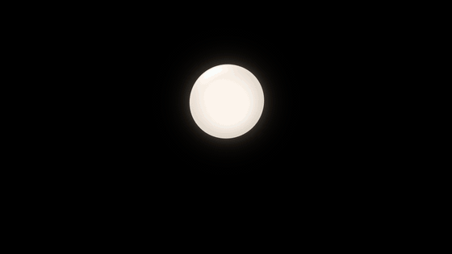
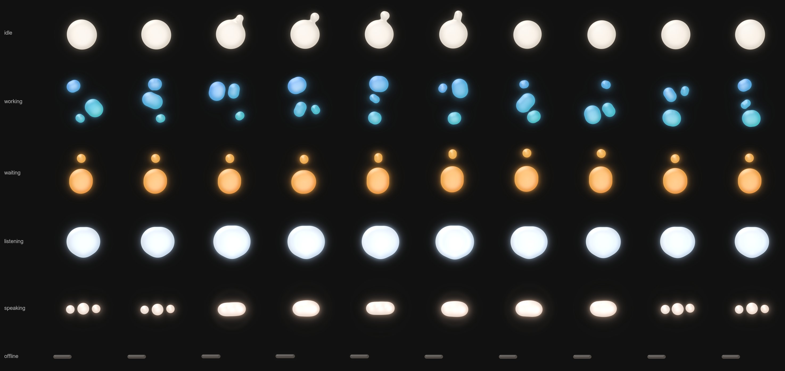
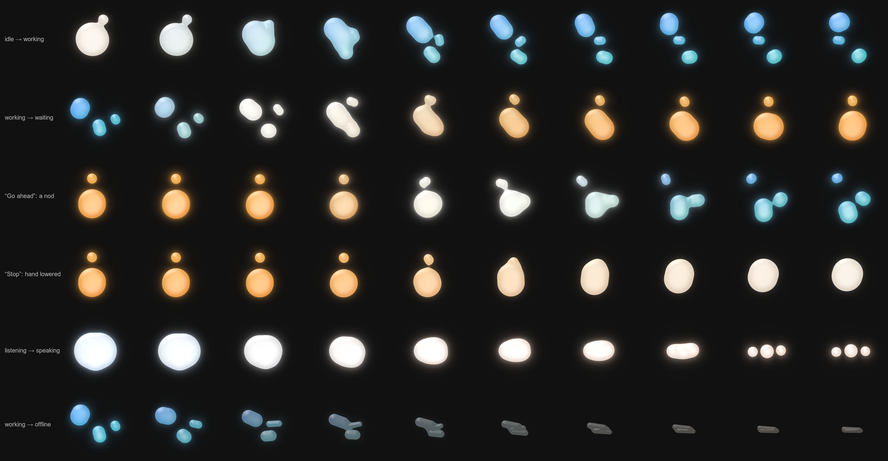
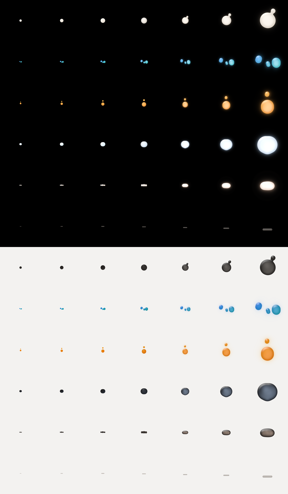
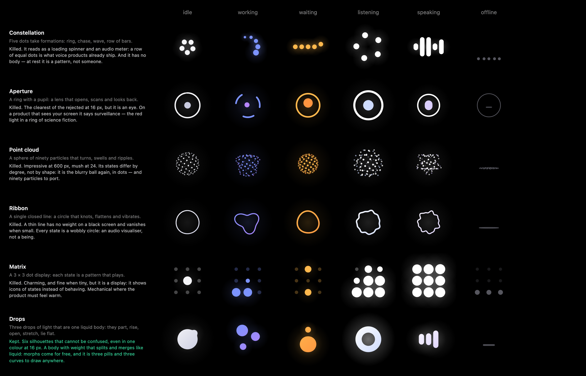

# The presence



*The same film at 60 frames a second: [presence/presence.mp4](presence/presence.mp4).
Live, with every state, every change of state, the answers and your own microphone:
`pnpm --filter @agentos/presence dev`.*

## The idea

The agent is **three drops of light that behave as one liquid body**. At rest
they are a single round drop, breathing. To work they part and juggle; to ask,
one rises above the body like a raised hand; to listen they gather into one
soft body that leans towards you; to speak they line up as three round dots
that bounce on every syllable and melt into one liquid line when the voice is
loud; and when the agent cannot work, everything lies flat. Each state is a different
*shape* doing a different *thing* — colour only confirms it — and because
the drops are liquid, any state flows into any other: they bud, stretch a
thread, snap and fuse, never cut. It is the only brand element; the logo is
one frame of it.

It is a small being **without a face**. It speaks through posture, timing and
breath: a glance now and then, a raised hand that waves and grows patient, a
lean towards whoever talks, a nod after "go ahead", a lowered hand after
"stop", a lift each time it tries to reconnect. Every one of those gestures
happens because something really happened.

Its motion has three layers, each built on the one before:

| Layer | Its job | Where |
|---|---|---|
| **Choreography** | Says the state: the gesture you read | One function per state in `model.ts` |
| **Physics** | Makes it matter: drops stretch along their travel, travel along arcs, gather before they move, answer events | `model.ts`, from the springs of `motion.ts` |
| **Light** | Makes it alive while still: a soft light drifting inside, deeper towards the rim, a crescent of light at the top, a bloom, a surface that sways | `Frame.light`, drawn by the shader (web) or in layers of gradients (iPhone, watch) |

Everything below is implemented in `packages/presence/src` — `model.ts` (the
look, as a pure function), `motion.ts` (how it moves through time),
`palette.ts` (colours, from the design tokens), `webgl.ts` (the shader),
`field.ts` (the shader's shape on the CPU), `canvas.ts` (the page, and the
path renderer), `mark.ts`, `glyph.ts`, `svg.ts`. The iPhone and the watch
have the same model and motion in Swift (`apps/ios/Shared/Presence`), held
to the same numbers by `PresenceTests`. This document and that source are
meant to be enough to port it to anything that can fill a path.

## Anatomy

**The stage.** The figure lives on a square. All positions are in *stage
units*: centre (0, 0), edges at ±1, y pointing down. One unit is `u = size / 2`
pixels. Drops never leave the stage; their light may reach 1.25 stages, so a
renderer gives the canvas that much room. The body at rest has radius
`REST = 0.5`: **it fills half the stage**, the other half is room to move.

**Three drops** — `0` big, `1` middle, `2` small. Each is a *pill*: a
rectangle with fully round ends, centred on (x, y), `w` along its own axis and
`h` across, turned by `angle` (never more than a quarter turn: an upright
pill stays upright, with its sides swapped rather than turned by 90°). When
apart their radii are `0.30`, `0.22`, `0.15`.

**A frame** is what the model returns, in pixels relative to the centre of
the stage:

| Primitive | Count | What |
|---|---|---|
| `drops` | 3 | Pills `{x, y, w, h, angle}` |
| `bridges` | 3 | The membranes big–middle, big–small, middle–small, for renderers that fill paths: 8 points each, for `M p0 C p1 p2 p3 L p4 C p5 p6 p7 Z` |
| `hole` | 1 | A pill cut out of everything else, and `light.hole`, how deep. Zero size except when listening |
| `glows` | 3 | Soft discs `{x, y, r, alpha}`, one behind each drop, for renderers that fill paths |
| `from`, `to`, `halo` | — | Colours: the body's gradient and its glow |
| `light` | 1 | What the body is made of: `core` colour, `energy`, `flow`, `radial`, `bloom`, `rim`, `wobble`, `merge`, `hole`, `ripple`, `wave`, `time` |

**The model's input**: the blend (one per drop), `time`, `size`, `level`,
`theme`, `calm` — as before — and, from `motion.ts`, the blends' rates
(`velocity`), the colour's own blend (`tint`), when the last change began
(`changed`), when waiting began (`asked`), the followed voice (`voice`), the
last `pulse`, how far the light has flowed (`flow`) and a `seed`. All are
optional: `presence({ blend, time, size })` still draws every state.

## The six states

Each state places the three drops at time `t` (seconds), for a voice `level`
(0–1). `tiny` (0–1) is explained under *Small sizes*; read the formulas with
`tiny = 0` first. Nothing loops: wherever the old version had a fixed period,
the new one has seeded noise.

- `noise(x, seed)`: a value per whole `x` from an integer hash (`hash()`,
  32-bit multiplies only, so every platform agrees to the bit), eased between
  with a quintic, −1 … 1. `drift(x) = 0.7·noise(x) + 0.3·noise(2.13x + 17.3)`.
- `breathe(t, P)`: in for 40 % of the period, out for 60 %, no corner at the
  turns (`−cos(πφ/0.4)` then `cos(π(φ − 0.4)/0.6)`); its phase wanders by
  `0.08·drift(t/13)`, so two breaths are never the same length.
- `settle(t, d, b)`: how a spring of duration `d` and bounce `b` goes from 0
  to 1, from rest. Every gesture is built from these and from
  `bump(x, a, b) = sin²(π(x − a)/(b − a))`, so no gesture ever starts with a jolt.

### idle — resting, content

- Body: radius `0.5·(1 + 0.04·breathe(t, 5.6))`, at `(0.02·drift(t/5.3), 0.018·drift(t/6.1))`;
  never quite round (`w, h × (1 ± 0.022·drift(t/2.9))`), its long side turning
  slowly (`0.9·drift(t/23)` rad). Middle and small hidden inside.
- **Small gestures**, seeded: one in each 10.5 s slot, starting `3.5·hash(n)`
  into it, so 7–14 s apart, never regular. Its kind is `hash(n, seed + 202)`:
  - < 0.55 **a glance**: the small drop buds out up and to one side (one time in three, the left),
    on a spring (0.55 s, 0.25), slides 0.28 rad along the surface as it looks
    around, and sinks back after 1.55 s (0.65 s, 0); the body leans 0.014 towards it;
  - < 0.85 **a settle**: the body sinks 0.02 and spreads 3 %, holds, rises back;
  - otherwise **a stretch**, rarely: 5 % taller, then back — a kind of yawn.

### working — absorbed, kneading

- Drop `k` runs a figure of eight: `phase = 2πt/4.2 + k·2π/3 + 0.25·drift(t/9 + 5k)`,
  `a = phase + 0.22·sin(2·phase)` — so the drops rush through the middle and
  linger at the ends — `x = reach·sin a`, `y = 0.3·sin 2a`,
  `reach = 0.58 + 0.03·drift(t/7)`. The figure turns about once in 40 s
  (`2πt/40 + 0.35·drift(t/31)`).
- The drops stretch along their travel (*Physics*), and as they cross they
  melt into each other more softly and glow a little brighter, as if they
  traded energy.

### waiting — a raised hand, a small wave, patience

- Body: diameter `0.84`, centred low at `y = 0.27`, standing 3 % taller than
  round, breathing quicker (`± 2 %` over 2.6 s). Hand: radius `0.15`, at
  `y = −0.5`, floating `0.02·drift(t/1.1)`.
- **The wave**, every 4.8 s from 0.35 s after waiting began (`u` = seconds
  into it): the body gathers (squash `0.06·bump(u, 0, 0.36)`), lifts
  (`0.075·bump(u, 0.18, 0.92)` — the velocity stretches it), lands
  (`0.045·bump(u, 0.8, 1.12)`) and rebounds once. The hand dips with the
  gather, lifts `0.17` on a spring 90 ms behind (`settle(u − 0.27, 0.5, 0.4) − settle(u − 0.95, 0.55, 0.2)`)
  and, as it lands, waves: `x = 0.05·sin(2π(u − 0.7)/0.7)·(1 − e^(−τ/0.08))·e^(−τ/0.45)`.
  The light swells with it.
- **Patience, not nagging**: after a minute with no answer, a wave every 6.4 s
  at 70 %; after five minutes, every 9.6 s at 60 %.

### listening — leaning in

- **One soft body**, gathered, wider than it is tall: radius
  `0.47 + 0.12·heard`, `w × 1.06`, `h × 0.96`, with
  `heard = 0.65·level + 0.35·slow` — it swells with the voice instead of
  twitching. The middle drop gathers inside; the small one rests low and
  forward, so the body's weight hangs towards you. It breathes `± 3 %` over
  4.2 s and is never quite round (`± 1.6 %`). No hole, no ring.
- **Leaning in**: while someone talks (`slow`, the level followed over half a
  second) it comes closer — `0.04` lower, wider (`+5 %`), shorter (`−4 %`).
  In silence it leans in a little now and then (one 1.4 s lean in each
  6.5 s slot, seeded): attentive, not frozen.
- In the light: soft rings of light travel **inward** inside the body and
  dissolve into an even glow before the heart (never a dot, never a pupil);
  each syllable sends a band of light in from the edge in 600 ms.

### speaking — the dots talk

- **Three round drops** in a row: the middle one `0.19` in radius, the sides
  `0.135` at `x = ∓0.44`, sitting a little low so that they have room to
  bounce. Each drop's lift rides on **a spring of its own** (`motion.ts`:
  0.3 s / 0.55 for the middle one, about 0.33 s / 0.5 for the sides) towards
  `[0.1, 0.07, 0.07]·level·(0.6 + 0.4·sin(ωt + 2.4k))`; each syllable
  **throws** them up — the middle one at once, the sides 70 and 120 ms later
  — for 140 ms. A drop stretches as it rises and, landing below rest,
  squashes instead of sinking.
- **Loud** (`smoothstep(0.4, 0.9, level)`), the side drops grow to the middle
  one's size and draw in by `0.2`, their bounce shrinks to a soft swell, and
  the joins soften (`merge + 0.22·loud`): the three melt into one smooth
  liquid capsule. Soft, they stay three dots. In a pause they breathe `± 5 %`
  one after the other: never dead.
- In the light: the inner light travels **outward**, and on black each
  syllable sends a faint ring of light out from the row.

### offline — still and honest

- A short warm-grey dash, `0.58 × 0.085` at `y = 0.2`. Nothing depends on
  time: the renderer stops drawing.
- **A reconnection attempt** (`pulse("retry")`) lifts it `0.02` and
  lengthens it 6 %, then lays it down again within a second. Nothing moves in
  between.



## Physics

All of it comes from the springs and the choreography; none of it has a clock
of its own.

- **Velocity stretch.** Each drop's velocity `v` (stage units a second) is
  measured from the model itself, a moment ahead with the blends moved on by
  their rates. The drop stretches along it by `s = min(0.2, 0.13·|v|)` and
  thins across it, keeping its area: `w × (1 + s)`, `h ÷ (1 + s)`, turned to
  the direction of travel. The rates the drops feel lag the springs by 60 ms
  (`drag` in `motion.ts`), so a stretch builds up over a few frames and lets go
  softly. Gestures that only deform (a gather, a nod) do not stretch.
- **Arcs.** Between two states a drop does not travel in a straight line: it
  is pushed sideways by `κₖ·wₛ·wₛ'·⟂(Pₛ' − Pₛ)` for every pair of states it is
  between (`κ = 0.35, 0.5, 0.7`: the small drop curves most). It is zero at
  either end, so the poses are untouched.
- **Shapes blend as tensors.** A pill is blended as its centre and its
  half-extent tensor `R·diag(w/2, h/2)·Rᵀ`, so turned and upright shapes mix
  without caring about angles; the result is turned back into a pill.
- **Anticipation.** Before a change (except to or from offline) the body
  gathers itself: the drops keep their course for 80 ms while the body
  squashes `0.022·bump(since, 0, 0.24)`, then they go.
- **Pulses** — real events only, each a pure function of the seconds since:
  - `approved` (after "go ahead"): a nod — the body dips 0.04 in 160 ms and
    springs back on the `gesture` spring — and a little light;
  - `denied` (after "stop"): the body exhales (lowers 0.022, widens, dims, on
    `layout` then `material`), and the hand comes down on a slow spring with
    no bounce (0.7 s, 0);
  - `retry` (offline): the lift above.

## From one state to another

**The blend.** The model does not take a state but a *blend*: one weight per
state. Each drop's pose is the weighted sum of its pose in every state, so
any mix of states is a valid figure and a change of state is a morph by
construction. Each drop may have its own blend.

**Springs**, as `(duration, bounce)` — the same numbers as SwiftUI's
`Spring(duration:bounce:)` and motion's `visualDuration`; `ω = 2π / duration`,
`ζ = 1 − bounce`. `motion.ts` moves each drop's blend on its own spring,
solved exactly (critically damped when the bounce is 0) so that the result
does not depend on the frame rate. Each kind of change has its own feel:

| Change | Big | Middle | Small |
|---|---|---|---|
| Ordinary | 0.62 s, 0.15 | `gesture` (0.5 s, 0.25) | 0.42 s, 0.40: leads, bounces once |
| To waiting | 0.62, 0.15 | `gesture` | 0.40, 0.45: the hand pops up |
| To offline: deflate | 0.9, 0 | 0.8, 0 | 0.7, 0 |
| From offline: wake | 0.6, 0.2 | 0.55, 0.3 | 0.48, 0.35 |
| After "stop": lower | 0.62, 0.1 | 0.55, 0.1 | 0.7, 0 |

```
x = blend − target            v = its rate of change
ωd = ω·√(1 − ζ²)              c = (v + ζω·x) / ωd
blend' = target + e^(−ζω·dt) · (x·cos(ωd·dt) + c·sin(ωd·dt))
v'     = e^(−ζω·dt) · (v·cos(ωd·dt) − (x·ωd + c·ζω)·sin(ωd·dt))
ζ = 1:  c = v + ω·x,  blend' = target + (x + c·dt)·e^(−ω·dt),  v' = (c − ω·(x + c·dt))·e^(−ω·dt)
```

**Colour and light** follow their own blend, `tint`, on the design system's
`material` spring (0.6 s, no bounce): position may bounce, colour never does.
The hole opens on it too — after the body has begun to gather.

**A change of size** is a movement too — the presence steps aside when a
request needs the screen — on the design system's `layout` spring (0.45 s,
critically damped), so it moves with the layout around it. The first size
given, and any size in calm mode, is taken at once.

**The voice** is followed three ways: the level (`k = 24` a second rising,
`8` falling), a slow level (`k = 2`: "someone is talking"), and **onsets** —
a syllable starts where `(level − trail − 0.05)·5` (with `trail` at `k = 3`)
crosses 0.35, at most once every 140 ms. Onsets kick the speaking pills and
send the rings of light. Only `listening` and `speaking` hear it.

**The hole** cannot show as a pinhole: its depth `light.hole` follows its size
(`smoothstep(0.06, 0.2, radius)`), and while it is shallow its edge is soft
(up to `0.08u`). The ring opens like an iris.

**Membranes and joins.** The shader melts the drops together itself (a smooth
minimum of radius `light.merge`, larger while the figure is between two
states, so necks stretch longer before they snap). Path renderers use
`bridges`, which now reach as far as `0.8·merge`.



## Colours

The colours live in `@agentos/design` (`tokens.json` → `presence`), the one
source shared with CSS and Swift; `palette.ts` only reads them. Per state,
on black and as a black pearl on a light surface: the body's gradient
(`from` top left → `to` bottom right of the stage), the `core` (the
brightest light inside the body), the `halo` and the `glow` strength. On a
light surface only working and waiting glow.

They mix in **OKLab**. When two coloured states meet, a plain mix would lose
its colour and turn to mud (azure and amber cancel out into mauve): the mix
leans towards `presence.via` — the pearl on black, the ink on light — by how
much colour it would lose (`smoothstep(0.02, 0.09, lost chroma)`). A grey
never lights up: offline dims, it does not flash.

## The light

What `light` asks a renderer to draw:

| | idle | working | waiting | listening | speaking | offline |
|---|---|---|---|---|---|---|
| energy | 0.42 | 0.62 | 0.48 | 0.36 + 0.3·level | 0.38 + 0.5·level | 0 |
| flow (stage units/s) | 0.07 | 0.11 | 0.04 | 0.06 + 0.12·level, inward | 0.05 + 0.12·level, outward | 0 |
| wobble (stage units) | 0.007 | 0.011 | 0.008 | 0.003 | 0.008 + 0.004·level | 0 |
| merge (stage units) | 0.16 | 0.12 (+0.05 crossing) | 0.14 | 0.2 | 0.07 + 0.22·loud | 0.06 |

On a light surface the body is ink and the light inside it is a pearly sheen
(`energy × 0.55`) with the same crescent at the top: a black pearl. The
syllables' rings are not drawn there: a ring of ink would read as a grey halo.

**The shader** (`webgl.ts`, plain WebGL 1, one draw call), per pixel:

1. **Shape**: the three drops as capsules, joined with the polynomial smooth
   minimum of radius `merge`; near the edge, space sways by `wobble`
   (`p += W·(sin(2.6y + φ₁ + 0.8 sin(1.9x + φ₂)), sin(2.3x + φ₂ + 0.8 sin(2.1y − φ₁)))`);
   the edge anti-aliased to the pixel.
2. **Body**: the stage gradient in linear light, deeper towards the rim; a
   pearly field that flows with `flow` — crests lean to `core`, troughs to
   `halo` — and broad soft pools of light drifting through it (nothing thin,
   nothing that reads as a scratch); rings that travel in or out with
   `radial` and dissolve before the heart; a soft highlight up and to the
   left that drifts slowly; a crescent of light just inside the top edge.
3. **Around**: a bloom of `halo` (a close light and a faint tail) and a
   syllable's `wave`. Written as sRGB, premultiplied, with a whisper of
   dither against banding.

Everything that grows with time is wrapped into a phase on the CPU, so it
stays smooth after hours on screen. `field.ts` is the same shape on the CPU,
for tests and for checking a port.

**The path renderer** (`paint`, Canvas 2D; `PresencePaths` in Swift) draws
the same frame without a shader: the pills and their membranes in the stage
gradient, the glows behind, and on each outer drop layered gradients — deeper
towards the rim, a soft light up and to the left, a crescent at the top. The
iPhone adds a glow shaped like the body (a blurred copy), a second pool of
light, both drifting with the flow, and the soft rings; the watch keeps the
lighter set, for its battery. Membranes start where the shader's smooth union
starts to join two edges, and narrow back before a drop sinks into another,
so that nothing pops.

## Small sizes

Like a typeface, the figure has optical sizes. `tiny = 1 − smoothstep(28, 72, size)`:
0 from 72 px up, 1 at 28 px and below. As it grows:

- the bloom fades out (`× (1 − tiny)`); the wobble and the flow go below
  48 px, the rim below 28;
- the small gestures go well before that (`× (1 − smoothstep(0, 0.6, tiny))`);
- the body fills more of the stage (rest radius 0.5 → 0.74), the ring and the
  dash get thicker, the small drops larger — the `tiny` terms in the code;
- nothing is ever thinner than 2 px.

It stays itself down to 16 px. For anything that cannot move — favicon, app
icon — use **the mark** (`mark(size)`; `pnpm --filter @agentos/presence brand`
redraws every brand asset in `packages/design/brand` from it and from the
tokens, and the copies the apps ship): the three drops caught mid-juggle,
the big and the middle one joined by a neck, the small one free. Big
`(-0.30, 0.20)` r `0.48`; middle `(0.36, -0.42)` r `0.30`; small
`(0.60, 0.42)` r `0.19`; when tiny, the middle drop moves `0.045` towards the
big one and the small one grows by `0.04`.

Where a state must show but nothing can move or take a colour — the menu
bar — use **a glyph** (`glyph(state, size)`, for `idle`, `working`,
`waiting`, `offline`). Each is the model's own calm frame for that state (for idle, the mark),
scaled into an 18 px box, every pill then moved onto whole pixels; other
sizes are that drawing scaled, so 36 px is exactly the @2x image. Working,
whose juggle never repeats, is one fixed instant of it. As a set they are
balanced for one colour:

| Glyph | Taken from | Bent how | On the 18 px grid |
|---|---|---|---|
| idle | the mark at 18 px | drawn at 0.78: the brand, and still the quiet one | discs of 7, 4 and 3, the first two joined |
| working | a fixed instant of the juggle, as drawn at 30 px, × 1.08, one pixel lower | drops apart, big to small clockwise, no small drop above a big one (that is `waiting`); no membrane | discs of 7, 5 and 4, at least 1.5 px apart |
| waiting | the calm frame at 18 px (no wave) | drawn at 1.07, as tall as a menu bar allows: the tallest and the heaviest | body 10, raised drop 4, 2 px apart, 16 high |
| offline | the calm frame at 18 px | drawn at 1.3: a longer dash | 12 × 3 |



## Reduced motion

When the system asks for less motion (`calm`): **the shapes stay, the travel
goes, a breath of light remains.**

- No breath, drift, glance, wave, stretch, arc, wobble, ripple or flow; the
  pulses only brighten or dim the light.
- working: the drops stand still in a triangle (`0.46` from the centre, the
  big one on top, the whole lowered by `0.06`) and swell in turn, in place.
- listening and speaking follow the voice at 60 % of its level, without the
  syllables' bounce.
- The light breathes `± 3 %` over 5.6 s — brightness, not motion — drawn 15
  times a second; offline, nothing.
- A change of state is not a morph: the figure fades out in 150 ms (`exit`),
  changes, and fades back in.

## The web renderer

```ts
import { createPresence } from "@agentos/presence";

const presence = createPresence(element, { size: 240 });   // or a <canvas>
presence.set({ state: "listening" });
presence.set({ level: 0.6 });        // as often as the microphone reports
presence.set({ size: 96 });          // eased: the presence steps aside
presence.pulse("approved");          // "go ahead": a nod. Also "denied", "retry"
presence.resize(320);                // at once
presence.destroy();
```

- **Two tiers.** Stages of 64 px and up are drawn with light (the shader),
  while the page has no more than six of them (browsers cap live WebGL
  contexts); smaller stages, and browsers without WebGL, are drawn with paths
  (`paint`, Canvas 2D). If the GPU is lost, the presence carries on with
  paths. `renderer: "webgl" | "2d"` forces one; `presence.renderer` says which.
- Given an element, it adds a canvas 1.25 stages wide, centred, so that the
  light has room; without `size` the stage is the element's smaller side and
  follows it. Given a canvas, the stage fills it.
- **Device pixels** are capped at 2 per CSS pixel, and at 2.4 million a canvas.
- **Frame budget** (`pace()`): 60 a second while something travels (working,
  a voice, a gesture, a change, a pulse), 30 at rest (idle, waiting between
  waves, silent voice states), 15 for calm mode's breath of light, **none**
  when nothing can change (offline at rest). Never more than 60, even on a
  120 Hz display. It stops when the page is hidden or the canvas off screen.
- **Nothing is allocated per frame**: the frame, the model's input and the
  shader's numbers are filled in place (`presence(input, frame)`,
  `inputOf(motion, size, options, input)`).
- `theme: "auto"` reads the `color-scheme` of the element: a presence surface
  stays dark in a light system. `calm: "auto"` follows `prefers-reduced-motion`.
- Lower level: `presence(input, into?)` → `Frame`; `createPainter(canvas)` →
  `draw(frame, scale)`; `paint(ctx, frame)`; `createMotion()` / `stepMotion()`
  / `pulse()` / `pace()` / `inputOf()`; `shape(frame)`; `toSVG(frame)`;
  `mark(size)`; `glyph(state, size)`.

**Measured** on an Apple M4 in headless Chrome (GPU on, ANGLE Metal), one
presence alone on a 1920 × 1080 page at 2× — a 600 px stage, so a
1500 × 1500 px canvas — over 10 s per state. CPU is the processor time of
Chrome's renderer and GPU processes, in % of one core; the machine was doing
other work, so read differences of a point or two as noise.

| State | Frames drawn | Script per frame | CPU, renderer + GPU processes | Before (flat paths), same page |
|---|---|---|---|---|
| idle | 40 /s (30 at rest, 60 in a gesture) | 0.15 ms | 4 % + 4 % | 30 /s, 0.21 ms, 4 % + 4 % |
| working | 60 /s | 0.11 ms | 5 % + 7 % | 60 /s, 0.14 ms, 4 % + 5 % |
| waiting | 41 /s (60 in a wave, 30 between) | 0.14 ms | 4 % + 5 % | 61 /s, 0.14 ms, 5 % + 7 % |
| listening, a voice | 54 /s (30 in pauses) | 0.14 ms | 6 % + 7 % | 60 /s, 0.17 ms, 6 % + 8 % |
| speaking, a voice | 54 /s | 0.12 ms | 5 % + 7 % | 60 /s, 0.14 ms, 5 % + 7 % |
| offline | 0 | — | 0 | 0 |
| idle, reduced motion | 15 /s (a breath of light) | 0.17 ms | 3 % + 2 % | 0 |

On the GPU, a 1500 × 1500 frame of the shader costs about what clearing
the same canvas costs (each forced to finish: 1.35–1.67 ms against 1.35 ms,
on a busy machine): the shading itself adds well under a millisecond. The model and the
motion allocate no object and no array per frame — what is left is the
numbers JavaScript boxes on its own, 0.2–1 KB a frame against 7–8 KB before.
Not measured: WebKit (the desktop app's web view) and a real phone.

## On the iPhone and the watch

`apps/ios/Shared/Presence` is the same presence in Swift:

1. **`PresenceModel.swift`, `PresenceMotion.swift`, `PresencePalette.swift`**
   are `model.ts`, `motion.ts` and `palette.ts`, line for line and name for
   name: plain arithmetic on `Double`. `hash()` is 32-bit integer arithmetic
   and matches to the bit. The colours and the springs come only from the
   design tokens (`Tokens.Presence`, `Tokens.Motion`), never from a constant.
2. **`PresenceView`** draws with the path renderer in a `Canvas`
   (`PresencePaths`, `paint` in `canvas.ts` with the layered light above), on
   the iPhone and the watch alike — the watch with the lighter set, at 30
   frames a second at most, and holding a calm frame when the display dims
   (`isLuminanceReduced`). A Metal shader (`colorEffect`) could draw the web's
   light on the iPhone later; it is deliberately not used, so that building
   the app needs nothing beyond Xcode.
3. **It draws only as often as it must**: `Motion.pace()` (60, 30, 15 or 0
   frames a second), and nothing while the app is not in front.
4. **It is fed** the state from the computer's status, the level from the
   audio engine's meter (0–1), the appearance (`appearance`: light on black,
   or the black pearl; OS mode and the watch are always dark) and `pulse`:
   the store sends `approved` or `denied` once the computer has the owner's
   answer, and `retry` at each attempt to reach it again.
5. **`PresenceGlyph`** is a state frozen still, beside words ("Nova is
   asking"); **`PresenceMark`** is the mark.
6. **`PresenceTests`** holds it to the TypeScript model: every state at six
   sizes and moments, ninety-six blends a spring could produce, a day of
   changes with a voice and pulses (the motion and its frames after every
   step), the membranes and the mark — `apps/ios/Scripts/export-presence-reference.mjs`
   writes the reference. `-demo gallery` shows every state side by side, to
   compare with the web's `?demo=presence`.

## How it was chosen

Six directions were prototyped in one playground
(`packages/presence/playground/concepts.html`) and judged in motion, at
16 px and at 600 px, on black and on a light surface.



- **Constellation** — killed. A loading spinner and an audio meter; a row of equal dots is what voice products already ship, and it has no body.
- **Aperture** — killed. Clear at any size, but it is an eye: on a product that sees your screen, it says surveillance.
- **Point cloud** — killed. Impressive large, mush small; states differ by degree, not shape — the blurry ball again, in dots.
- **Ribbon** — killed. A thin line has no weight on black and every state is "a wobbly circle": a visualiser, not a being.
- **Matrix** — killed. Charming and tiny-friendly, but a display showing icons of states, not something that behaves.
- **Drops** — kept, and refined into what this document describes: six silhouettes that cannot be confused even in one colour at 16 px, a body with weight, morphs for free.

A design pass (November 2026) then found it "clean as a still image, basic in
motion": paint, not light; rigid discs on rails; short exact loops. It kept
the six silhouettes, the morphs and the glyphs, and added the light inside the
body, the physics and the body language described above ("Companion" on a
"Liquid Light" renderer).
