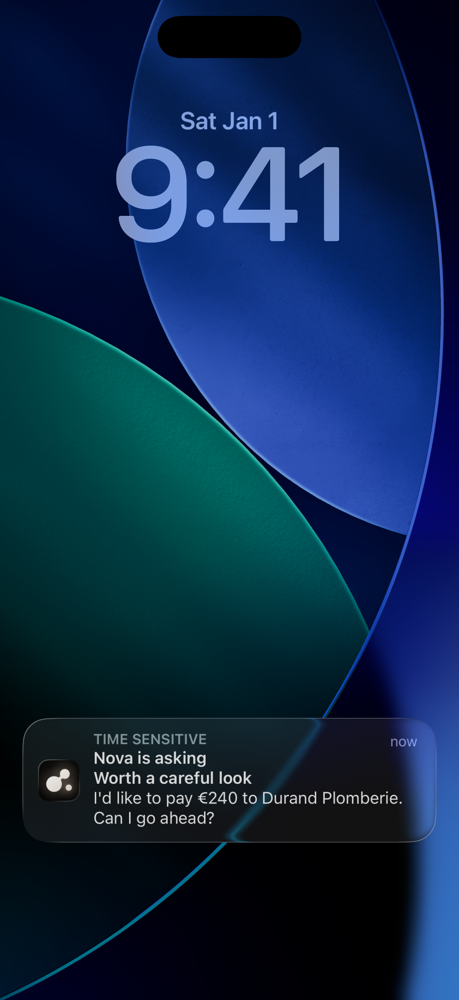

# The iPhone and Apple Watch apps

The apps are not in the App Store yet: you build them from source, with
Xcode. They live in [`apps/ios`](../apps/ios), written in Swift and SwiftUI.

**Where this stands.** The iPhone app runs in the simulator against the real
core. It has not yet been verified on a real iPhone: on-device speech, the
Earbuds mode and notifications through Apple's servers are the parts that
only real hardware can prove. The Apple Watch companion has been built
and run in the simulator, not yet on a real watch.

## What you need

- A Mac with Xcode 26 or later (the apps target iOS 26 and watchOS 26)
- [XcodeGen](https://github.com/yonaskolb/XcodeGen): `brew install xcodegen`
- A core running on your Mac: see [Getting started](getting-started.md)

## Build and run in the simulator

The Xcode project is not checked in. XcodeGen writes it from
[`project.yml`](../apps/ios/project.yml):

```sh
cd apps/ios
xcodegen
open AgentOS.xcodeproj
```

In Xcode, choose the **AgentOS** scheme and an iPhone simulator, then Run.
Nothing else is needed: the design tokens come as a Swift file already in the
repository, and the presence is drawn with SwiftUI's `Canvas`, on the iPhone
and the watch alike, with no shader or other build step.

*`xcodegen` was run from a fresh copy of the repository and lists the three
schemes. The app and the watch app were built for the simulator with
`xcodebuild` while these pages' screenshots were made.*

### Try it without a computer

A debug build has a made-up computer inside, for screenshots and for trying
the app: launch it with `-demo <scene>`. Nothing in it is anybody's real
computer, and nothing leaves the phone.

```sh
xcrun simctl launch booted org.agentos.app -demo request
xcrun simctl launch booted org.agentos.app -demo gallery -AppleLanguages "(fr)"
```

| Scene | On screen |
|---|---|
| `home` | Nova at rest |
| `working` | Nova at work on a website, a backup running in the background |
| `request` | A high-risk payment, with what Nova sees |
| `question` | A question with Nova's own options and a picture |
| `approval` | A medium-risk approval, with its command under Details |
| `answered`, `stopped` | The payment, answered on this phone: Go ahead, or Stop |
| `conversation`, `history`, `empty` | The conversation: a request waiting in it, what was answered, or nothing yet |
| `computers` | The list of computers |
| `offline` | The computer out of reach |
| `pairing`, `pairing-confirm` | Adding a computer |
| `notification` | The payment as a notification, 5 s in: lock the phone or go home |
| `gallery` | The presence in each of its states |

The watch app (`org.agentos.app.watchkitapp`) takes the same argument:
`presence`, `working`, `request` (high risk), `sure` (its "Just to be sure"
page), `answered`, `question`, `offline` and `gallery`. The words follow the
device's language, English or French; `-AppleLanguages "(fr)"` picks French.
The screenshots in [`screenshots/ios`](screenshots/ios) and
[`screenshots/watch`](screenshots/watch) come from these scenes. Listening
and speaking need a real microphone, so they have no screenshot yet.

### Add the simulator as a phone

The simulator has no camera, so paste the link instead of scanning the code:

```sh
pnpm agentos pair
```

Copy the `agentos://pair?…` line it prints, then choose **Paste** on the
app's first screen. The app shows the computer's name and the addresses it
will use, and adds it only once you confirm. A simulator on the same Mac
reaches the core without anything else.

## Run on your own iPhone

`project.yml` has one place for what is yours:

```yaml
settings:
  base:
    APP_BUNDLE_ID: org.agentos.app   # change it to an identifier of your own
    DEVELOPMENT_TEAM: ""             # your Apple developer team id
```

Set both, run `xcodegen` again, choose your iPhone in Xcode, and Run. Then
add it as a phone by scanning the code on your computer.

The app asks for the camera (to scan the code), the local network (to reach
your computer at home), the microphone and speech recognition (to talk).

*Not verified on real hardware yet. The app uses push notifications and
time-sensitive notifications, which Apple grants to paid developer accounts
only.*

## What is in the project

| Target | What |
|---|---|
| `AgentOS` | The iPhone app: home, conversation, requests, adding computers, voice |
| `AgentOSNotifications` | A small extension that attaches what the agent sees to a notification |
| `AgentOSWatch` | The Apple Watch app. It talks to the iPhone app, not to computers |
| `AgentOSTests` | Unit tests: the protocol, pairing links, the store, voice, the presence |

Things worth knowing before you change something:

- **The protocol is mirrored by hand** in `AgentOS/Protocol`, from
  [`packages/protocol`](../packages/protocol). The tests decode fixtures of
  real answers (`AgentOSTests/Fixtures`), so a change on one side that the
  other missed fails loudly.
- **The presence is a port** of the TypeScript model, line for line
  (`Shared/Presence`), drawn in a SwiftUI `Canvas`: with the light inside the
  body on the iPhone, a lighter version on the watch. `PresenceTests` holds
  it to reference frames exported from the original. After changing
  `packages/presence`, export them again:

  ```sh
  pnpm --filter @agentos/presence build
  node apps/ios/Scripts/export-presence-reference.mjs
  ```

- **Colours, type, sizes, springs and haptics are tokens**, the same as
  everywhere else. `pnpm build` generates
  [`packages/design/generated/Tokens.swift`](../packages/design/generated/Tokens.swift)
  from `packages/design/tokens.json`, and `project.yml` adds that file to
  the app and to the watch app. `Shared/Theme.swift` builds the buttons and
  surfaces on top of it instead of copying values. To change a colour or a
  spring, edit `tokens.json` and run `pnpm --filter @agentos/design build`.
- **Words** are in string catalogs, in English and French.
- **A phone's key to a computer** is kept in the Keychain, on that phone
  only: not in iCloud, not in backups to another device.
- **The computer's certificate is pinned.** The pairing link carries its
  fingerprint, and `AgentOS/Net/NodeClient.swift` refuses any other
  certificate on a direct address, on every connection. A relay's address is
  checked the usual way.
- **The watch talks to the phone**, never to a computer: it shows each
  computer's presence, or the question it is asking, and sends the answer
  through the phone.

## Notifications

While the app is open, and in Earbuds mode, the phone hears from your computer
directly. When the app is closed, your computer has to ask Apple to deliver
a notification, and Apple only accepts that from whoever built the app.

So this part belongs to the person who builds the iOS app. Create a push
signing key (a `.p8` file) in your Apple developer account, then give the
core four things:

| Variable | What |
|---|---|
| `AGENTOS_APNS_KEY` | The `.p8` file's path, or its contents |
| `AGENTOS_APNS_KEY_ID` | The key's id |
| `AGENTOS_APNS_TEAM_ID` | Your Apple developer team |
| `AGENTOS_APNS_TOPIC` | The bundle id of your build of the app |

Until all four are there, notifications to a closed app are simply off;
everything else works. A request then arrives as a time-sensitive
notification, "Nova is asking", with the picture of what the agent sees when
there is one and two buttons, **Go ahead** and **Stop**. The push carries the
request's risk: at high risk the notification says "Worth a careful look"
and puts Stop first. Every action on a notification needs the phone
unlocked.



Keep the `.p8` file out of the repository: `.gitignore` refuses `*.p8`.

*The sending side is tested against a stand-in for Apple's servers. It has
not been verified through the real ones.*
